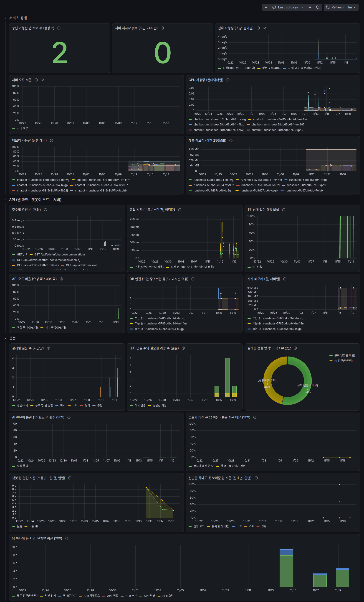

<!--
다루는 곳: backend/src/main/resources/application.yml, backend/src/main/java/com/kopo17/runshoes/activity/ActivityCleanup.java, backend/src/main/resources/db/migration/V19__chatbot_turns.sql, backend/src/main/resources/db/migration/V20__summary_batch_runs.sql, backend/src/main/resources/db/migration/V21__grafana_compare_views.sql
읽은 커밋: 0d49616
-->
# 10-01 모니터링

사이트가 떠 있는지, 요청에 얼마나 빨리 답하는지, 오류가 얼마나 나는지는 Grafana 대시보드 「runshoes 운영」 한 장에서 본다. 지표를 모으고 쌓는 도구(Prometheus, Loki, Grafana)는 인프라 저장소가 클러스터 전체를 위해 세운 것이고, 런슈즈는 그 도구가 읽을 숫자와 기록을 내놓는다. 이 편은 런슈즈 쪽만 다룬다. 도구를 어떻게 세우고 무엇을 긁는지는 인프라 기술문서 「모니터링」에 있다. [docs:06_deployment.md:152]

## 숫자가 오는 곳

대시보드의 숫자는 네 곳에서 온다. [docs:06_deployment.md:154]

첫째는 클러스터의 입구와 쿠버네티스 자체다. 바깥에서 들어온 요청이 몇 건이고 결과가 무엇이었는지는 입구(ingress-nginx, 바깥 요청을 받아 안쪽 서버로 넘기는 문지기)가 세고, 앱 Pod(함께 뜨고 함께 내려가는 프로그램 묶음)가 요청을 받을 준비가 됐는지, 몇 번 다시 켜졌는지, CPU와 메모리를 얼마나 쓰는지는 쿠버네티스가 안다. 이 값들은 런슈즈가 따로 내놓는 것이 없고 인프라의 수집기가 센다. [docs:06_deployment.md:158]

둘째는 Spring 서버가 내놓는 지표다. 서버는 바깥에서 닿지 않는 관리용 포트에 지표 창구를 하나 열어 두고, 주소별 요청 수, 응답 시간, 오류 상태, 데이터베이스 연결 풀(미리 열어 둔 연결 묶음), Java 메모리를 내놓는다. Prometheus(지표를 정해진 간격으로 긁어 와 시간 순으로 쌓는 저장소)가 30초마다 이 창구를 긁는다. [docs:06_deployment.md:159] 이 창구를 바깥에서 닫아 둔 데는 까닭이 있다. 전에는 서버 상태 창구가 공개 주소에 열려 있었고, 지표 창구를 더하면 그것까지 인터넷에 열린다. 그래서 상태와 지표 창구를 관리용 포트로 옮기고, 그 포트는 바깥으로 내보내지 않았다. [docs:06_deployment.md:130]

셋째는 런슈즈 데이터베이스다. 챗봇 대화 한 턴마다 남는 기록, 하루 한 번 도는 리뷰 요약 배치의 실행 기록, 로그인과 찜과 리뷰 쓰기 같은 활동 기록이 여기 있다. Grafana는 이 표들을 원본이 아니라 복제본에서 읽고, 읽기만 하는 전용 계정을 쓴다. [docs:06_deployment.md:160] 이 계정은 칸 단위로 권한을 받아, 챗봇 기록의 질문과 답 칸은 읽을 수 없다. 대시보드는 숫자만 보면 되고, 사람이 쓴 글은 개인정보에 가깝기 때문이다. [docs:07_database.md:118] [docs:07_database.md:140]

챗봇이 Prometheus 창구 대신 데이터베이스에 남기는 데도 까닭이 있다. 챗봇은 지표 창구가 따로 없고, 한 턴이 끝날 때마다 갈래, 걸린 시간, 단계별 시간, 코드가 대신 쓴 답인지, 보여 준 신발 수를 한 줄로 남긴다. 대시보드는 그 줄을 센다. [docs:06_deployment.md:165] 턴 하나의 기록이 남아 있어서, 관리 화면에서는 같은 줄로 개별 대화를 보고 대시보드에서는 그 줄들을 모아 추세를 본다(→ 「운영 장치」). [docs:09_chatbot_rag.md:453]

넷째는 서버가 남기는 기록(로그)이다. 앱, 챗봇, 요약 배치가 쓰는 줄을 수집기가 모아 Loki(로그를 모아 찾아볼 수 있게 쌓는 저장소)에 넣는다. 챗봇의 질문 원문이 든 줄은 수집기에서 버려, 로그에도 대화 글이 남지 않는다. [docs:06_deployment.md:161]

그래픽카드 사용률과 그 위에 올라간 AI 모델도 대시보드에 있지만, 런슈즈만의 값은 아니다. 그래픽카드 한 장을 펫퍼민트와 나눠 쓰고, 그 값은 인프라가 호스트에서 긁는다. [docs:06_deployment.md:166]

## 대시보드에 있는 것

대시보드는 인프라 저장소의 생성기 스크립트가 만든다. 화면에서 고친 것은 남지 않아서, 무엇이 대시보드에 있는지는 늘 그 스크립트가 답이다. 기본 범위는 7일이고 1분마다 새로 고친다. [docs:06_deployment.md:170] 묶음 일곱에 패널 36개가 있다(2026-11-20 생성기를 돌려 셈). [docs:06_deployment.md:171]

| 묶음 | 패널 | 보는 것 |
| --- | --- | --- |
| 서비스 상태 | 7 | 응답할 수 있는 앱 서버 수(정상은 2), 최근 24시간 재시작 횟수, 결과별 요청량, 서버 오류 비율, CPU, 메모리 |
| API | 6 | 주소별 요청 수, 응답 시간, 1초 넘게 걸린 요청 비율, 요청 쪽과 서버 쪽 오류 비율, DB 연결, Java 메모리 |
| 챗봇 | 8 | 갈래별 질문 수, 연결 수와 계정 수, 갈래를 정한 방식, 코드가 대신 쓴 답 비율, 답 걸린 시간, 단계별 시간 |
| AI 서버(그래픽카드) | 3 | 사용률, 메모리, 올라간 모델 |
| 사이트 활동 | 7 | 리뷰 쓰기, 찜과 "도움이 돼요", 가입과 탈퇴, 로그인, 체험 로그인, 많이 본 신발, 많이 비교한 조합 |
| 리뷰 요약 배치 | 3 | 회차별 걸린 시간, 만든 켤레와 실패한 켤레, 끝나지 못한 회차 |
| 서버 기록 | 2 | 챗봇 로그, 앱과 요약 배치 로그 |

[docs:06_deployment.md:175-181]

맨 위 묶음이 "사이트가 떠 있나"에 답한다. 앱 서버는 두 대가 서로 다른 노드에서 돌고, 둘 다 요청을 받을 수 있으면 2다. 배포 중에는 한 대씩 바꾸므로 잠깐 1이 된다. 앱 서버는 데이터베이스까지 붙어야 준비된 것으로 치므로, 데이터베이스가 멈춰도 이 숫자가 떨어진다. [docs:06_deployment.md:175] [docs:06_deployment.md:85] [docs:06_deployment.md:88] "얼마나 빠른가"는 API 묶음의 응답 시간이, "오류가 얼마나 나나"는 서버 오류 비율과 API 오류 비율이 답한다. API 오류는 요청 쪽(400번대)과 서버 쪽(500번대)을 나눠 그린다. 로그인하지 않고 쓰기를 누른 것처럼 요청 쪽 오류는 늘 조금 있고, 서버 쪽이 0이어야 정상이다. [docs:06_deployment.md:176]

응답 시간은 어림값이다. 서버가 응답 시간을 50ms, 100ms, 300ms, 1초 네 구간으로만 세기 때문에, "보통"과 "느린 편" 선은 구간 사이를 이어 짐작한 값이다. 구간을 더 잘게 나누면 주소, 방식, 결과 조합마다 칸이 늘어 저장할 시계열이 크게 늘어서 넷만 두었다. 대신 "1초 넘게 걸린 요청 비율"은 짐작이 아니라 센 값이다. [docs:06_deployment.md:145] [docs:06_deployment.md:210]

사이트 활동 묶음의 리뷰 쓰기 칸은 늘 비어 있다. 고장이 아니다. 이 칸은 화면에서 새로 쓴 리뷰만 세는데, 지금 있는 리뷰 1,800건은 가상 사용자 200명이 쓴 것으로 꾸며 화면을 거치지 않고 넣은 시드라 세지 않는다. 운영 공개 API의 리뷰는 2026-11-20에도 시드와 같은 1,800건이다. [docs:06_deployment.md:185] [docs:01e_seed_reviews.md:10] 챗봇 묶음도 2026-11-14 전은 비어 있다. 대화 기록이 그날 운영에 올랐기 때문이다. [docs:06_deployment.md:186] 그 밖의 빈 칸도 대개 그 기간에 쓴 사람이 적어서 생긴다. 체험 계정 31개를 여러 사람이 함께 쓰므로, 챗봇 묶음의 계정 수도 사람 수가 아니다. [docs:09_chatbot_rag.md:464]

대시보드와 관리 화면은 일을 나눴다. 숫자와 추세는 대시보드가 보고, 개별 대화나 개별 리뷰는 관리 화면이 본다. 같은 숫자를 관리 화면에 다시 그리지 않는다. [docs:06_deployment.md:187]

## 보존 기간

어디에 쌓이느냐에 따라 남는 기간이 다르다. [docs:06_deployment.md:189]

| 무엇 | 얼마나 |
| --- | --- |
| Prometheus 지표(요청, 응답 시간, CPU, 메모리) | 15일 또는 9GB 가운데 먼저 닿는 쪽 |
| Loki 로그 | 7일 |
| 활동 기록 | 로그인과 계정 기록 90일, 리뷰, 찜, 비교 같은 나머지 180일 |
| 챗봇 대화 기록 | 줄과 숫자는 지우지 않고, 질문과 답 글만 90일 뒤 비운다 |
| 리뷰 요약 배치 기록 | 지우지 않는다 |

[docs:06_deployment.md:193-197]

활동 기록과 챗봇 기록은 매일 새벽 4시(서울) 앱 서버 한 대가 정리한다. 두 대가 같은 시각에 깨어나므로 데이터베이스 잠금을 먼저 잡은 쪽만 정리하고 다른 쪽은 넘어간다. [docs:06_deployment.md:195] [docs:06_deployment.md:87] 챗봇 기록에서 줄을 지우지 않는 것은 대시보드가 그 숫자 칸을 읽기 때문이고, 질문과 답만 활동 기록보다 짧게 두는 것은 사람이 쓴 글이 통째로 들어 있어서다. [docs:07_database.md:185]

그래서 15일보다 긴 범위로 대시보드를 보면, Prometheus에서 오는 패널은 15일보다 앞이 비고 데이터베이스를 읽는 챗봇, 활동, 요약 배치 패널은 기록이 남은 만큼 보인다. [docs:06_deployment.md:201]

## 알림

알림은 두지 않았다. 대시보드에서 무언가 나빠져도 누구를 부르지 않고, 사람이 대시보드를 열어야 안다. [docs:06_deployment.md:205] 모니터링 도구를 맡은 인프라가 적은 까닭은 무엇을 누구에게 알릴지 아직 정하지 않았다는 것이다. 런슈즈는 그 도구 위에 있어 알림도 그 결정을 기다린다. [docs:06_deployment.md:205]

앱 쪽에는 걸 자리를 하나 만들어 두었다. 매일 정리가 끝나면 남은 활동 기록 행 수를 로그 한 줄로 쓰고, 50만 행을 넘으면 경고 줄을 쓴다. 이 줄에 경보를 거는 일은 아직 정해지지 않았다. [docs:06_deployment.md:206]

## 아직 보지 않는 것

[docs:06_deployment.md:208]

- 챗봇에서 코드가 대신 쓴 답이 왜 그렇게 됐는지, 거절한 질문이 몇 건인지, 답 아래 "보러 가기"를 누른 비율, 동시에 열린 연결 수는 아직 재지 않는다. 챗봇 작업을 먼저 끝내고 재기로 미뤘다(2026-11-12 결정). [docs:06_deployment.md:211]
- 브라우저 쪽, 곧 화면이 뜨기까지 걸린 시간과 화면에서 난 오류는 모으지 않는다. 화면 코드에 수집 장치가 없고, 왜 두지 않았는지는 기록에 없어 할 일로 올렸다. [docs:06_deployment.md:212]
- 바깥에서 사이트를 직접 불러 보는 확인이 없다. 서비스 상태 묶음은 클러스터 안에서 본 값이라, 바깥 길(터널이나 이름 풀이)에서 막히면 요청이 0으로만 보인다. 이것도 까닭이 기록에 없어 할 일로 올렸다. [docs:06_deployment.md:213]
- 데이터베이스 자체의 지표(복제가 얼마나 늦는지, 느린 쿼리, 디스크)는 모으지 않는다. 대시보드는 앱 쪽에서 본 연결 풀만 보여 준다. 까닭이 기록에 없어 할 일로 올렸다. [docs:06_deployment.md:214]
- Prometheus와 Loki는 한 대씩이고 한 노드에 묶여 있어, 그 노드를 비우는 동안은 지표와 로그가 빈다. 인프라 쪽 한계다. [docs:06_deployment.md:215]

## 알려진 한계

- 이 서비스 전체에 걸린 한계와 조건은 → 「알려진 한계」 한 편에 모았다.

## 용어 풀이

- 지표: 요청 수, 걸린 시간, 메모리처럼 시간에 따라 바뀌는 숫자. 정해진 간격으로 읽어 쌓아 두면 그래프가 된다
- 시계열: 지표 하나를 시간 순으로 쌓은 줄. 지표의 이름과 꼬리표(주소, 결과 등) 조합마다 하나씩 생긴다
- 복제본: 원본 데이터베이스를 따라 쓰는 사본. 읽기만 하는 일을 여기로 보내면 원본이 덜 바쁘다
- 대시보드: 여러 그래프를 한 화면에 모아 둔 판
