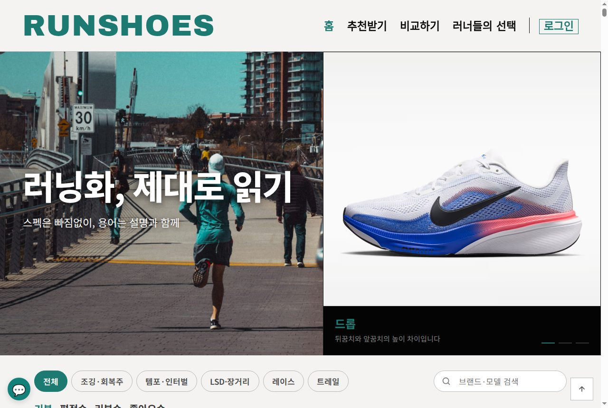

<!--
다루는 곳: README.md, src/App.tsx, Dockerfile, Dockerfile.chatbot, Jenkinsfile
읽은 커밋: 0fd9641
-->
# 한눈에 보는 RUNSHOES

> 이 글은 RUNSHOES가 무엇이고 어떤 화면으로 이루어져 있는지, 그 뒤에서 무엇이 도는지를 한자리에 모아 보여 드립니다.

**RUNSHOES는 러닝화 310켤레(2026-11-17 운영 공개 API)의 스펙과 리뷰를 한곳에 모은 아카이브 사이트입니다. 어려운 용어에는 바로 풀이가 뜨고, 모르는 값은 짐작으로 채우지 않고 "정보 없음"으로 남깁니다.** [docs:requirements.md:10] [docs:overview.md:6] [docs:requirements.md:48]

## 무엇을 만들었나

러닝화 정보는 대개 이미 잘 아는 사람을 기준으로 쓰여 있습니다. 드롭(뒤꿈치와 앞꿈치 밑창 높이의 차이)이나 스택하이트(발바닥 아래 밑창의 두께) 같은 말이 풀이 없이 나열되고, 제조사가 발표한 무게와 리뷰 사이트가 직접 잰 무게가 섞여 있습니다. 한국 러너가 많이 묻는 발볼 너비와, 발볼이 넓은 사람을 위한 와이드 모델이 국내에 나오는지는 해외 사이트가 다루지 않습니다. [docs:requirements.md:14] [docs:requirements.md:15] [docs:requirements.md:16]

그래서 정보를 덜어 내지 않고 모르는 말을 없애는 쪽을 골랐습니다. 스펙은 빠짐없이 보여 드리되 용어마다 풀이를 붙였습니다. 쇼핑몰이 아니어서 구매 버튼이나 할인 표시는 없고, 가격은 제조사가 처음 매긴 발매가만 보여 드립니다. [docs:requirements.md:47] [docs:requirements.md:61]

## 화면 여덟

이 포트폴리오는 화면 하나를 한 편씩 다룹니다. 편마다 화면을 먼저 보여 드리고, 그 화면이 무엇을 해 주는지 설명합니다. [docs:02_screens.md:10]

| 화면 | 하는 일 | 편 |
| --- | --- | --- |
| 신발 목록 | 용도로 거르고, 이름으로 찾고, 줄을 세웁니다 | → 「신발 목록」 |
| 신발 상세 창 | 스펙과 용어 풀이, 리뷰 요약과 리뷰를 봅니다 | → 「신발 상세 창」 |
| 추천받기 | 다섯 가지에 답하면 세 켤레를 골라 드립니다 | → 「추천받기」 |
| 비교하기 | 점수 없이 스펙을 나란히 놓고 견줍니다 | → 「비교하기」 |
| 러너들의 선택 | 평점과 리뷰로 세운 순위입니다 | → 「러너들의 선택」 |
| 챗봇 | 신발을 말로 물어봅니다 | → 「챗봇」 |
| 로그인과 마이페이지 | 체험 계정으로 들어가 찜과 리뷰를 남겨 봅니다 | → 「로그인과 체험 계정」 |
| 관리 화면 | 신발을 등록하고 고치고 숨깁니다 | → 「관리 화면」 |

## 신발 데이터와 리뷰

신발 값은 사람이 한 켤레씩 쳐서 넣은 것이 아닙니다. 약관이 허락하는 공개 출처에서 사실 값만 모으고, 값마다 어디서 읽었는지를 함께 저장했습니다. 그 출처는 관리 화면에서 볼 수 있습니다. [docs:overview.md:10] [docs:03_admin.md:10]

리뷰 1,800건(2026-11-17 운영 공개 API)은 실제 사용자가 쓴 것이 아닙니다. 둘러볼 거리를 만들려고, 가상 사용자 200명이 실제 신발에 대해 쓴 것으로 꾸민 시드 데이터입니다. 그래서 평점과 순위를 실제 평판으로 읽으시면 안 됩니다(→ 「러너들의 선택」). [docs:01e_seed_reviews.md:10] [docs:overview.md:81]

## 뒤에서 도는 것

화면은 React, 서버는 Spring Boot, 데이터는 MySQL에 있습니다. 챗봇은 파이썬으로 만든 별도 프로그램으로 서버 옆에서 돌고, 답을 짓는 언어 모델(글을 읽고 이어지는 글을 지어내는 AI)은 그래픽카드가 있는 호스트에서 돕니다. [docs:overview.md:10] [docs:09_chatbot_rag.md:457] [docs:overview.md:73]

서버는 처음부터 Spring Boot가 아니었습니다. 과제 요건대로 간단한 JSON 서버로 시작했고, 그 응답을 녹화해 두고 새 서버가 똑같이 답하도록 재현한 뒤 바꿔 끼웠습니다. [docs:requirements.md:31] [docs:05_api_contract.md:10] 배포는 코드를 저장소에 올리면 Jenkins가 이미지를 만들고 ArgoCD가 그것을 클러스터에 반영하는 길로 사람 손 없이 이어지고, 데이터베이스 구조를 바꿀 때만 사람이 문을 엽니다. [docs:06_deployment.md:10] [docs:06_deployment.md:103] 이 둘은 보여 드릴 화면이 없어 여기까지만 다룹니다. 자세한 것은 기술문서 [「Spring 전환과 API 계약 시험」](../notion/09_spring.md)과 [「배포」](../notion/10_deploy.md)에 있습니다. 운영 중인 서버가 잘 도는지 지켜보는 대시보드는 → 「모니터링」에서 보여 드립니다.

## 무엇이 어려웠나

서버를 바꿀 때는 무엇을 정답으로 삼을지가 갈림길이었습니다. 코드를 읽고 쓴 계획서를 따라 만들어도 그럴듯해 보였지만, 목표는 화면을 한 줄도 고치지 않는 것이었습니다. 그래서 옛 서버의 실제 응답을 녹화해 정답으로 삼았고, 녹화해 보니 계획서가 틀린 곳이 넷이었습니다. 대신 삭제하면 빈 객체를 돌려주는 것처럼 화면이 기대던 옛 서버의 이상한 동작까지 그대로 지고 갑니다. [docs:05_api_contract.md:144] [docs:05_api_contract.md:145]

비교하기는 신발마다 쿠션 점수를 매겨 그림으로 보여 줄 수도 있었습니다. 하지만 가진 값은 브랜드와 리뷰가 낸 공시값뿐이라 점수를 매기면 근거 없는 판정이 되어, 점수 없이 표만 두고 값이 어디쯤인지만 알려 드립니다. [docs:08_compare.md:131] 추천받기에서는 처음에 데이터가 빈 칸을 "안 맞음"과 같은 0점으로 두었습니다. 그러자 빈 칸이 있는 신발은 거의 추천되지 않아, 판단할 수 없는 조건은 아예 세지 않는 쪽으로 바꿨습니다. [docs:10_recommend.md:82]

여러 화면에 걸친 한계는 → 「알려진 한계」에 모았습니다. 왜 이렇게 만들었고 무엇이 어려웠는지는 기술문서 [「전체 그림」](../notion/00_overview.md)에 있습니다.
