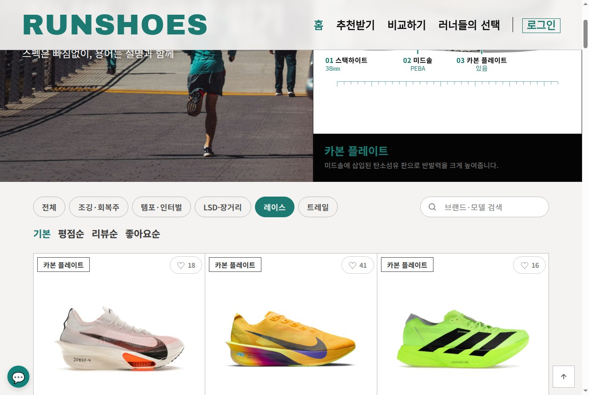
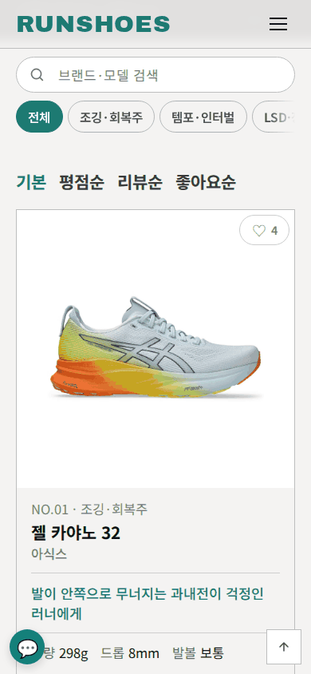

<!--
다루는 곳: src/pages/ShoeList.tsx, src/components/ShoeCard.tsx, src/components/FilterBar.tsx, src/components/SortBar.tsx, src/components/CardRowSync.tsx, catalog/copy.json
읽은 커밋: 72cde47
-->
# 신발 목록

> 이 글은 RUNSHOES의 첫 화면인 신발 목록이 신발을 어떻게 거르고 찾고 줄 세우는지, 카드 한 장에 무엇을 담았는지를 보여 드립니다.

**신발 목록은 러닝화 310켤레(2026-11-17 운영 공개 API)를 카드로 늘어놓는 홈 화면입니다. 용도로 거르고, 이름으로 찾고, 평점이나 리뷰 수로 줄을 세운 뒤 카드를 누르면 그 자리에서 상세 창이 열립니다.** [docs:01a_catalog_sources.md:6] [docs:02_screens.md:10]

## 거르고, 찾고, 줄 세우기

목록 위에는 용도 칩 여섯 개가 있습니다. 전체, 조깅과 회복주, 템포와 인터벌, LSD(천천히 오래 달리는 훈련)와 장거리, 레이스, 트레일 가운데 하나를 누르면 그 용도의 신발만 남습니다. [docs:02_screens.md:32] 검색창에 브랜드나 모델 이름을 치면 서버가 걸러 드립니다. 낱말을 여러 개 치면 모두 들어간 신발만 남고, 대소문자와 띄어쓰기는 따지지 않으며, 한글 표기와 영어 이름과 검색용으로 따로 둔 표기까지 보기 때문에 "젤카야노"나 "퓨어셀"로 쳐도 찾습니다. [docs:02_screens.md:33]

정렬은 기본, 평점순, 리뷰순, 좋아요순 넷이고, 로그인하면 찜한 신발만 보는 토글이 하나 더 생깁니다. 거르기와 정렬은 모두 서버가 하고, 화면은 받은 목록을 그리기만 합니다. [docs:02_screens.md:34] [docs:02_screens.md:35] 평점과 리뷰 수는 가상 사용자 200명이 쓴 시드 리뷰 1,800건(2026-11-17 운영 공개 API)에서 나온 값이라, 평점순과 리뷰순을 실제 평판으로 읽으시면 안 됩니다. [docs:01e_seed_reviews.md:6] [docs:01e_seed_reviews.md:10]

## 카드 한 장

카드에는 사진, 브랜드, 모델, 용도, 한 줄 요약과 함께 무게, 드롭(뒤꿈치와 앞꿈치 밑창 높이의 차이), 발볼, 안정성, 카본 여부, 평점, 리뷰 수, 찜이 들어갑니다. [docs:02_screens.md:35] 화면은 신발을 파는 상품이 아니라 관찰하는 표본처럼 보이게 꾸며서, 사진 칸은 흰 바탕이고 카드 사이는 1px 격자선으로만 나누며 구매 버튼이나 할인 배지는 두지 않았습니다. [docs:02b_design_system.md:10] [docs:02b_design_system.md:50] [docs:02b_design_system.md:19] 카드는 넓은 화면에서 한 줄에 셋, 태블릿 폭에서 둘, 휴대폰에서 하나씩 섭니다. [docs:02_screens.md:88]

한 줄 요약은 모은 값이 아니라 저희가 쓴 글입니다. 이 신발이 누구에게 맞는지를 "~에게"로 끝나는 50자 안의 한 문장으로 말하고, 무게나 밑창 두께 같은 숫자는 넣지 않습니다. [docs:01d_catalog_copy.md:10] [docs:01d_catalog_copy.md:23] [docs:01d_catalog_copy.md:24] 사진 속 "발이 안쪽으로 무너지는 과내전이 걱정인 러너에게"가 그 예입니다. 과내전은 달릴 때 발이 안쪽으로 지나치게 무너지는 것을 말합니다. [docs:01d_catalog_copy.md:27]

요약은 신발마다 길이가 달라서 그대로 두면 카드 높이가 들쭉날쭉해집니다. 그래서 화면에서 같은 줄에 뜬 카드끼리 모델명과 요약 칸을 그 줄에서 가장 긴 것에 맞춰, 아래의 스펙과 평점 줄이 한 줄 안에서 같은 높이에 오게 했습니다. 화면 폭이나 목록이 바뀌거나 글꼴이 늦게 도착하면 다시 잽니다. [docs:02_screens.md:36]

## 무엇이 어려웠나

요약에 무엇을 담을지가 첫 갈림길이었습니다. 처음에는 요약에 구체적인 수치나 특징을 한두 개 넣었는데, 그러자 "240g대의 … 러너에게"처럼 숫자와 기술명이 앞서 요약들이 서로 비슷하게 읽혔습니다. [docs:01d_catalog_copy.md:112] [docs:01d_catalog_copy.md:113] 카드에는 요약 바로 아래에 무게와 드롭 칸이 있어서, 요약에 숫자를 넣으면 같은 정보를 두 번 읽게 됩니다. 처음 보는 사람이 고르는 데 필요한 것은 "나에게 맞나"라고 보고, 요약을 "무엇"에서 "누구에게"로 바꾸고 숫자를 뺐습니다. 숫자는 요약이 아니라 그 아래 칸에서 읽으셔야 합니다. [docs:01d_catalog_copy.md:95]

카드 높이를 맞추는 방법도 갈렸습니다. 요약을 세 줄로 잘라 모든 카드를 같은 높이로 두는 쪽이 단순했지만, 요약이 짧은 카드에는 빈 줄이 생겼습니다. 그래서 자르기를 풀고 같은 줄의 카드끼리만 높이를 맞추게 했습니다. 대신 줄마다 카드 높이가 달라지고, 화면이 바뀔 때마다 높이를 다시 재야 합니다. [docs:01d_catalog_copy.md:114] [docs:02_screens.md:36]

이 화면에 걸친 한계는 → 「알려진 한계」에 모았습니다. 화면이 어떻게 짜였고 요약을 어떤 규칙으로 썼는지는 기술문서 [「둘러보기와 상세」](../notion/03_screens/01_browse.md)와 [「카드 요약과 설명 문구」](../notion/01_catalog/05_copy.md)에 있습니다.
