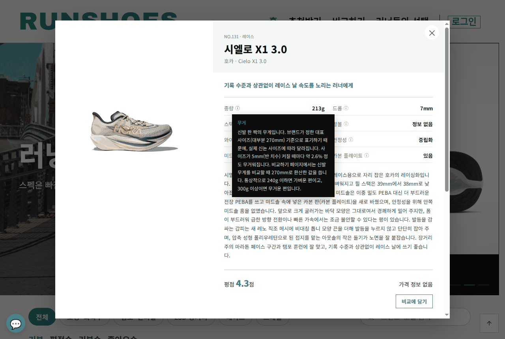
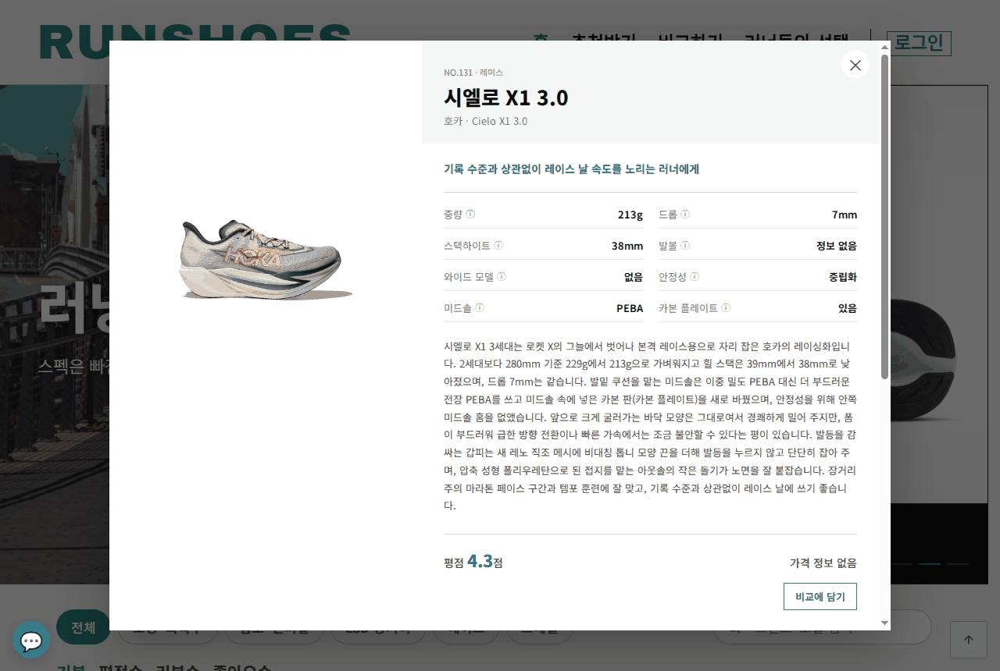
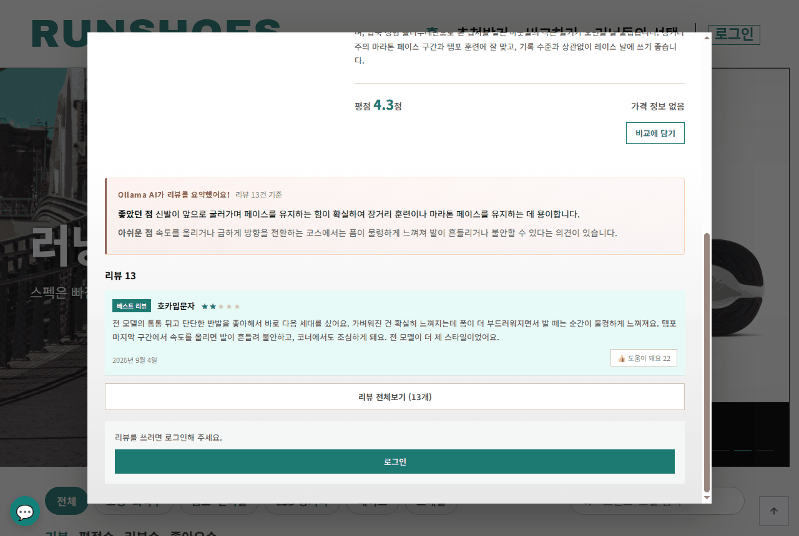

<!--
다루는 곳: src/components/ShoeModal.tsx, src/components/TermTooltip.tsx, src/utils/display.ts, src/utils/terms.ts, src/components/ReviewSummary.tsx, src/components/ReviewSection.tsx, catalog/copy.json, backend/src/main/java/com/kopo17/runshoes/summary/
읽은 커밋: 0fd9641
-->
# 신발 상세 창

> 이 글은 카드를 누르면 열리는 상세 창이 스펙을 어떻게 풀어 보여 주고, 모르는 값을 어떻게 남기고, 리뷰를 어떻게 모아 보여 주는지를 보여 드립니다.

**상세 창은 신발 한 켤레의 스펙 여덟 칸과 설명문, 평점과 발매가, AI 리뷰 요약과 리뷰를 한 창에 담습니다. 칸마다 용어 풀이가 붙고, 모르는 값은 짐작으로 채우지 않고 "정보 없음"으로 남깁니다.** [code:src/components/ShoeModal.tsx:117-208] [docs:02_screens.md:44] [docs:02_screens.md:45]

## 스펙 여덟 칸과 용어 풀이

창 위쪽에는 표본번호와 용도, 모델 이름이 있고, 브랜드 옆에는 영어 모델 이름이 붙습니다. [docs:02_screens.md:43] 그 아래 강조색 굵은 글씨가 한 줄 요약이고, 이어서 중량, 드롭, 스택하이트(발바닥 아래 밑창의 두께), 발볼, 와이드 모델(발볼이 넓은 사람을 위해 같은 신발을 넓게 만든 판), 안정성, 미드솔(쿠션을 맡는 중간 밑창), 카본 플레이트 여덟 칸이 놓입니다. [docs:02_screens.md:49] [code:src/components/ShoeModal.tsx:117-208] 칸 이름 옆 ⓘ를 누르면 작은 풀이 창이 뜨고, 한 번에 하나만 열리며 화면 밖으로 나가지 않습니다. [docs:02_screens.md:44] 사진의 중량 풀이는 무게가 대부분 270mm 기준이고 반 치수마다 약 2.6% 달라진다고 알려 줍니다(2026-11-19 운영 화면). 그래서 비교하기에서는 무게를 270mm로 맞춘 값으로 견줍니다(→ 「비교하기」). [docs:01a_catalog_sources.md:119] [docs:01a_catalog_sources.md:129]

스펙 아래의 설명문은 라인의 내력, 이번 세대의 변화, 구조, 핏, 쓰임을 스펙 칸의 값과 리뷰 근거 문장만으로 쓴 글입니다. [docs:01d_catalog_copy.md:10] 러닝화를 처음 고르는 사람도 읽도록 "발밑 쿠션을 맡는 미드솔"처럼 용어는 처음 나올 때 한 번만 풀어 씁니다. [docs:01d_catalog_copy.md:41]

## 정보 없음과 발매가

값을 모르는 칸은 숨기지도, 그럴듯한 기본값으로 메우지도 않고 "정보 없음"이라고 적습니다. [docs:02_screens.md:45] 와이드 모델 칸은 있음, 국외에만 있음, 없음, 정보 없음 넷 가운데 하나입니다. 사진의 "없음"은 다섯 단계를 다 찾아도 와이드 모델이 나오지 않았다는 뜻이고, "정보 없음"은 아직 찾지 않았거나 찾다 막혔다는 뜻이라 둘을 나눠 적습니다. [docs:02_screens.md:46] [docs:01a_catalog_sources.md:204] [docs:01a_catalog_sources.md:205]

가격은 칸 밖 아래 줄에 평점과 나란히 놓이고, "발매가 199,000원"처럼 제조사가 처음 매긴 값만 보입니다. 할인가나 최저가는 어디서도 쓰지 않습니다. [docs:02_screens.md:48] [docs:01a_catalog_sources.md:151] 발매가를 모르면 사진처럼 "가격 정보 없음"이 뜹니다. [code:src/components/ShoeModal.tsx:216-217] 값마다 읽은 곳을 함께 저장해 두었지만 그 출처는 관리 화면에서만 보이고, 상세 창에는 값과 풀이만 있습니다. [docs:01a_catalog_sources.md:10] [docs:03_admin.md:10] 창 아래의 "비교에 담기"를 누르면 이 신발이 비교하기에 들어갑니다. [docs:02_screens.md:56]

## AI 리뷰 요약과 리뷰

리뷰가 세 건 이상인 신발에는 리뷰를 좋았던 점과 아쉬운 점으로 묶은 AI 요약이 뜹니다. [docs:02_screens.md:50] [code:src/components/ReviewSummary.tsx:39-46] 이 요약은 창을 열 때 만드는 것이 아니라 하루 한 번 도는 배치(사람이 기다리지 않는 시간에 몰아서 하는 작업)가 미리 만들어 둔 것이고, 화면은 저장된 것을 읽기만 합니다. "리뷰 13건 기준"처럼 몇 건으로 만든 요약인지를 함께 적어, 어느 한 시점에 찍은 요약이라는 것을 밝힙니다. [docs:09_chatbot_rag.md:207] [docs:09_chatbot_rag.md:212] [docs:09_chatbot_rag.md:223] 요약의 재료인 리뷰 1,800건(2026-11-17 운영 공개 API)은 실제 사용자가 아니라 가상 사용자 200명이 쓴 시드 데이터입니다. [docs:01e_seed_reviews.md:6] [docs:01e_seed_reviews.md:21]

리뷰는 처음에 "도움이 돼요"를 가장 많이 받은 하나만 보이고, 나머지는 "리뷰 전체보기"로 펼칩니다. [docs:02_screens.md:51] 로그인한 사람은 별점과 10~300자 글로 리뷰를 남길 수 있습니다(→ 「로그인과 체험 계정」). [docs:02_screens.md:52]

## 무엇이 어려웠나

빈 칸을 어떻게 보일지가 첫 갈림길이었습니다. 발볼은 "보통", 와이드 모델은 "없음"으로 채우면 표가 꽉 차서 "스펙은 빠짐없이"라는 목표에 맞아 보였지만, 실제로 얼마나 모르는지가 가려지고 모르는 값을 적는 순간 거짓이 됩니다. 그래서 칸을 남기고 "정보 없음"이라고 적는 쪽을 골랐고, 표에 빈 곳이 보이는 것을 받아들였습니다. [docs:01a_catalog_sources.md:260] [docs:02_screens.md:94]

가격 옆에 읽은 곳과 날짜를 함께 적는 것도 정직해 보였습니다. 그런데 "크림 2026/11/01 기준"이라고 적으니 그 가게에서 지금 그 값에 파는 것처럼 보였습니다. 그래서 상세 창에서는 출처와 날짜를 빼고 관리 화면에만 두었고, 그만큼 창에서는 어디서 언제 읽은 값인지 알 수 없습니다. [docs:02_screens.md:48]

리뷰 요약은 창을 열 때마다 만들어도 돌아가기는 했습니다. 하지만 언어 모델(글을 읽고 이어지는 글을 지어내는 AI)을 돌리는 서버가 요청을 한 번에 하나씩만 받아 여러 사람이 열면 줄을 서고, 같은 그래픽카드를 쓰는 챗봇까지 느려졌습니다. [docs:09_chatbot_rag.md:199] [docs:09_chatbot_rag.md:203] [docs:09_chatbot_rag.md:204] 그래서 하루 한 번 미리 만들어 두는 쪽으로 바꿨고, 대신 리뷰가 달린 순간에는 요약이 바뀌지 않습니다. [docs:09_chatbot_rag.md:572] [docs:09_chatbot_rag.md:225]

이 화면에 걸친 한계는 → 「알려진 한계」에 모았습니다. 상세 창의 짜임과 값을 모으는 법, 요약을 만드는 법은 기술문서 [「둘러보기와 상세」](../notion/03_screens/01_browse.md), [「신발 데이터를 모으는 법」](../notion/01_catalog.md), [「리뷰 요약 배치」](../notion/08_chatbot/04_summary.md)에 있습니다.
