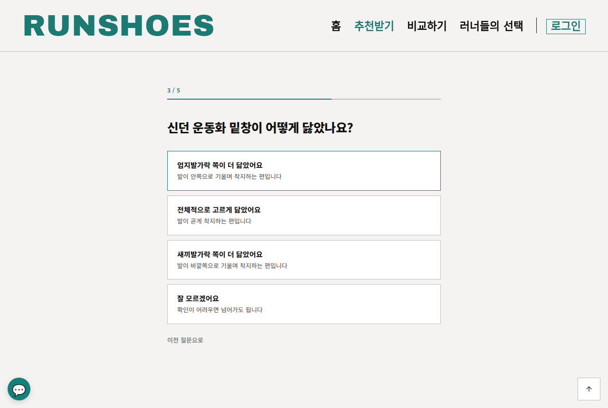
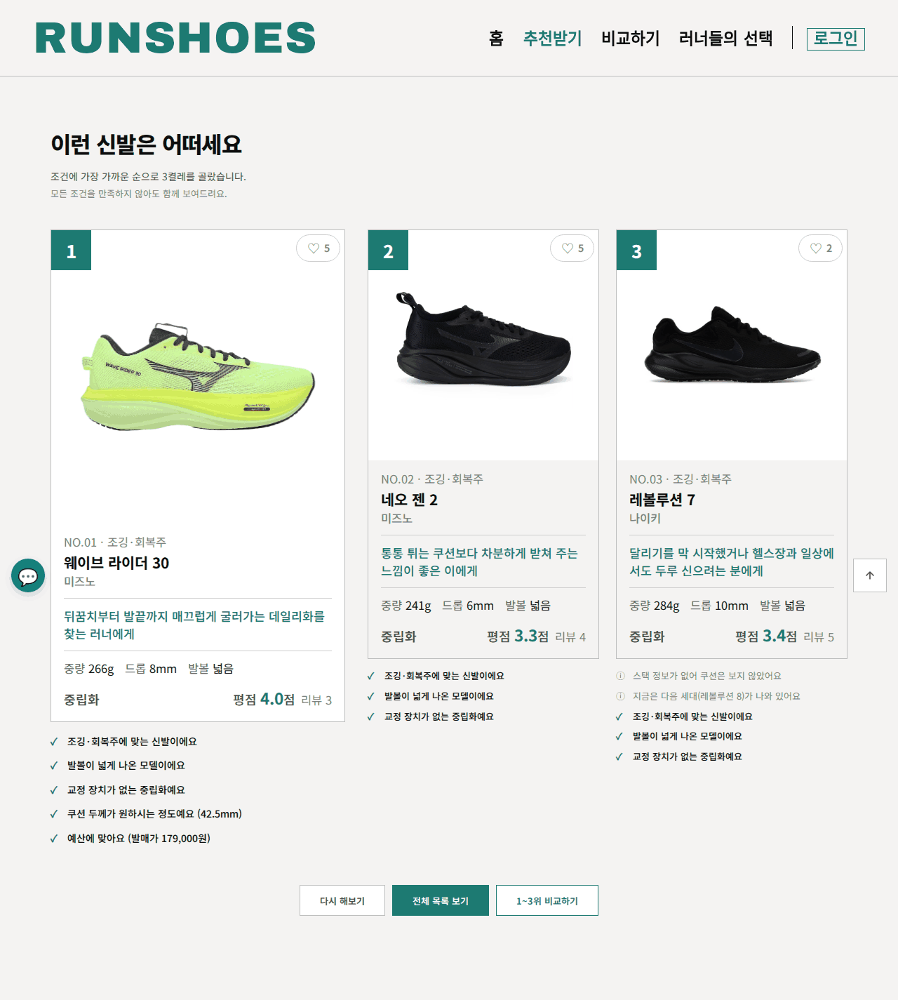

<!--
다루는 곳: src/pages/Recommend.tsx, backend/src/main/java/com/kopo17/runshoes/compare/
읽은 커밋: 0fd9641
-->
# 추천받기

> 이 글은 다섯 가지 물음에 답하면 신발 세 켤레와 그 까닭, 데이터가 없어 보지 못한 조건까지 알려 드리는 추천받기 화면을 보여 드립니다.

**추천받기는 러닝화를 처음 고르는 분께 용도, 발볼, 안정성, 쿠션, 예산 다섯 가지를 묻고, 러닝화 310켤레(2026-11-10 운영 공개 API) 가운데 답에 가장 잘 맞는 세 켤레를 골라 드립니다. 데이터가 없어 확인하지 못한 조건은 점수에서 빼고, 뺐다는 사실을 문장으로 알려 드립니다.** [docs:10_recommend.md:6] [docs:10_recommend.md:10]

## 다섯 가지 물음

물음은 한 화면에 하나씩 나옵니다. 용도가 맞으면 40점, 안정성이 맞으면 30점, 쿠션이 맞으면 20점, 예산에 들면 10점이고, 발볼은 넓은 편이라고 답했을 때만 조건이 되어 신발의 발볼이 넓으면 30점, 넓게 만든 와이드 모델이 있으면 20점입니다. 다섯 가지를 모두 물으면 만점은 130점입니다. [docs:10_recommend.md:20] [docs:10_recommend.md:21] [docs:10_recommend.md:22] [docs:10_recommend.md:23] [docs:10_recommend.md:24] [docs:10_recommend.md:26] 점수는 물어본 조건이 얼마나 맞는지만 재고, 신발의 인기나 몇 세대 모델인지는 넣지 않습니다. [docs:10_recommend.md:10]

안정성(발이 안쪽으로 무너지는 것을 신발이 얼마나 잡아 주는지)은 말로 묻지 않고, 사진처럼 신던 운동화 밑창이 어디가 닳았는지로 묻습니다. 그 답으로 안정화가 맞는지 중립화가 맞는지를 가립니다. [docs:10_recommend.md:22] 어느 물음이든 "잘 모르겠어요"를 고를 수 있고, 이 답은 그 조건을 묻지 않은 것으로 다룹니다. [docs:10_recommend.md:29] 예산은 원하는 가격대가 아니라 넘으면 안 되는 상한이라, 상한 안이면 5만원짜리든 19만원짜리든 똑같이 맞습니다. 예산만 10점으로 가벼운 것은 다른 네 조건은 신발이 바뀌지 않는 한 그대로인데, 예산은 발매가(제조사가 처음 매긴 정가)로 견주어 실제로 살 값과 다를 수 있기 때문입니다. [docs:10_recommend.md:24] [docs:10_recommend.md:113] [docs:10_recommend.md:114] [docs:10_recommend.md:115]

## 세 켤레와 그 까닭

결과 카드 아래에는 조건마다 맞았는지를 한 줄씩 적습니다. 1위는 까닭을 모두 보이고, 2위와 3위는 맞은 까닭을 셋까지만 보입니다. [docs:10_recommend.md:55] [docs:02_screens.md:61] 사진의 1위에는 "쿠션 두께가 원하시는 정도예요 (42.5mm)", "예산에 맞아요 (발매가 179,000원)"처럼 값까지 함께 적혀 있습니다(2026-11-19 운영 화면). 가격은 상세 창, 비교하기와 같이 어디서나 "발매가"라고 부릅니다. [docs:10_recommend.md:64] 예산을 넘은 신발에는 "지금 파는 값은 더 낮을 수 있어요"를 덧붙입니다. 지난 세대 모델은 실제로 파는 값이 발매가보다 낮은 경우가 많아, 발매가로 걸렀다는 사실만 알리면 그 신발을 바로 포기하게 되기 때문입니다. [docs:10_recommend.md:65]

결과 아래 "1~3위 비교하기"를 누르면 이 세 켤레가 그대로 비교하기로 넘어갑니다(→ 「비교하기」). [docs:02_screens.md:63]

## 확인하지 못한 조건은 세지 않습니다

모든 신발에 모든 값이 있지는 않습니다. 310켤레 가운데 스택하이트(발바닥 아래 밑창의 두께)를 모르는 신발이 19켤레, 발매가를 모르는 신발이 54켤레, 발볼을 모르는 신발이 69켤레입니다(2026-11-10). [docs:10_recommend.md:35] [docs:10_recommend.md:36] [docs:10_recommend.md:37] 쿠션을 물었는데 그 신발의 스택하이트를 모르면 그 조건을 점수에서도 만점에서도 함께 빼고, 줄은 판단한 조건에서 얻은 점수를 그 만점으로 나눈 비율로 세웁니다. [docs:10_recommend.md:35] [docs:10_recommend.md:45] 뺀 조건은 숨기지 않습니다. 사진의 3위처럼 "스택 정보가 없어 쿠션은 보지 않았어요" 같은 줄이 순위와 상관없이 까닭 목록 맨 위에 붙습니다. [docs:10_recommend.md:56] [docs:02_screens.md:61]

비율이 같으면 판단한 조건이 많은 쪽이 앞이고, 그래도 같으면 평점과 리뷰 수와 찜 수로 만든 종합 점수가 높은 쪽이 앞입니다. [docs:10_recommend.md:46] [docs:10_recommend.md:47] 이 평점과 리뷰는 가상 사용자 200명이 쓴 시드 리뷰 1,800건에서 나온 것이라, 동점이 많은 조합일수록 실제 평판이 아니라 가상의 인기가 순서를 정합니다(→ 「러너들의 선택」). [docs:10_recommend.md:153] [docs:overview.md:81]

## 무엇이 어려웠나

신발 쪽 빈 칸을 어떻게 셀지가 가장 큰 갈림길이었습니다. 처음에는 빈 칸을 "안 맞음"과 같은 0점으로 두었는데, 발볼이 빈 신발은 전체의 22.3%인데도 발볼을 물었을 때 1위에 오른 몫은 0.3%뿐이었습니다(2026-11-10). [docs:10_recommend.md:78] 사람이 고른 "모르겠어요"는 중립인데 신발 쪽의 모름은 감점으로 작동하고 있었습니다. 빈 칸에 평균 점수나 절반 점수를 주는 길도 있었지만 근거 없는 숫자가 된다고 보고, 판단할 수 없는 조건은 세지 않기로 했습니다. [docs:10_recommend.md:82] 그렇게 바꾸자 이번에는 반대로 기울었습니다. 조건이 적은 신발이 "전부 맞음"을 받기 쉬워, 용도와 안정성만 본 신발이 다섯 가지가 다 맞은 신발을 평점으로 이겼습니다. 그래서 판단한 조건이 많은 쪽을 앞에 두는 규칙과, 못 본 조건이 둘 이상이면 후보에서 빼는 하한선을 함께 넣었습니다. [docs:10_recommend.md:86] [docs:10_recommend.md:88] [docs:10_recommend.md:44]

세대도 갈림길이었습니다. 310켤레 가운데 143켤레가 지금 파는 모델이 아니지만 감점하지 않았습니다(2026-11-10). [docs:10_recommend.md:121] "지난 세대는 10점 감점"이라고 하면 왜 10점인지 답할 수 없고, 앞 세대가 낫다는 평도 흔하며 재고를 싸게 사는 사람도 많기 때문입니다. [docs:10_recommend.md:123] [docs:10_recommend.md:125] 대신 지난 세대가 자주 위에 오르므로, 같은 라인의 지금 모델을 사이트에서 열 수 있을 때만 "지금은 다음 세대가 나와 있어요"로 알려 드립니다. [docs:10_recommend.md:127]

이 화면에 걸친 한계는 → 「알려진 한계」에 모았습니다. 왜 이렇게 만들었고 무엇이 어려웠는지는 기술문서 [「추천받기」](../notion/04_recommend.md)에 있습니다.
