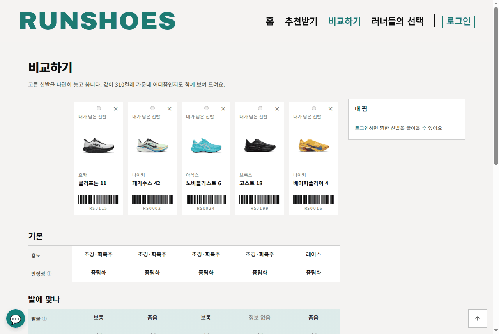
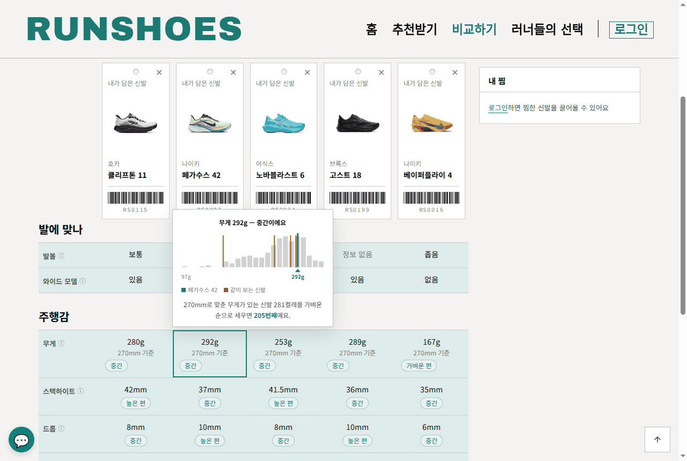
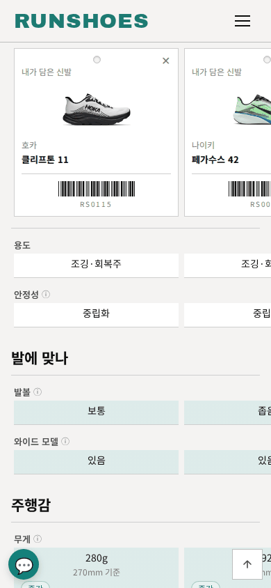

<!--
다루는 곳: src/pages/Compare.tsx, src/components/compare/, backend/src/main/java/com/kopo17/runshoes/compare/
읽은 커밋: 0fd9641
-->
# 비교하기

> 이 글은 고른 신발 두 켤레에서 다섯 켤레를 점수 없이 나란히 펼쳐 보는 비교하기 화면을 보여 드립니다.

**비교하기에는 점수도 순위도 더 나은 쪽 표시도 없습니다. 대신 숫자 칸마다 그 값이 310켤레(2026-11-09 운영 공개 API) 가운데 어디쯤인지를 말과 작은 분포 그래프로 알려 드립니다.** [docs:08_compare.md:6] [docs:08_compare.md:10]

## 들어오는 길과 채워 주기

비교하기는 로그인 없이 씁니다. 무엇을 비교하는지는 주소에 신발 번호로 적히므로, 그 주소를 남에게 보내면 받은 사람도 같은 표를 봅니다. [docs:08_compare.md:28] [docs:08_compare.md:58] 메뉴에서 들어올 수도 있고, 신발 상세 창의 "비교에 담기", 추천받기 결과의 "1~3위 비교하기", 찜 목록의 "선택 비교"로도 들어옵니다. [docs:08_compare.md:22] [docs:08_compare.md:23] [docs:08_compare.md:24] [docs:08_compare.md:25] 카드마다 왜 들어왔는지를 한 줄로 적어, 사진의 "내가 담은 신발"은 상세 창에서 담은 신발이라는 뜻입니다. [docs:08_compare.md:57]

처음 들어온 분은 비교할 후보가 없으니, 한 켤레만 고르면 나머지를 채워 드립니다. 같은 라인(세대가 바뀌어도 이어지는 같은 이름의 신발 줄기)의 다른 세대, 같은 브랜드의 비슷한 신발, 다른 브랜드에서 안정성이 다른 신발을 한 켤레씩 넣고, 모자라면 다른 브랜드의 비슷한 신발로 네 켤레를 만듭니다. [docs:08_compare.md:135] [docs:08_compare.md:42] [docs:08_compare.md:43] [docs:08_compare.md:44] [docs:08_compare.md:45] 안정성이 다른 칸을 넣은 것은 모두 중립화면 비교가 심심하기 때문이고, 이 칸으로 네 켤레의 안정성이 섞이는 경우가 0%에서 65%가 됐습니다(2026-11-09). [docs:08_compare.md:50] 채운 신발은 뺄 수 있고, 빼면 오른쪽이 한 칸씩 당겨지며 5초 동안 되돌릴 수 있습니다. [docs:08_compare.md:62] [docs:08_compare.md:65]

## 표와 빈 칸

표는 기본, 발에 맞나, 주행감, 평가, 가격의 다섯 묶음입니다. [docs:08_compare.md:78] [docs:08_compare.md:79] [docs:08_compare.md:80] [docs:08_compare.md:81] [docs:08_compare.md:82] 발에 맞나와 주행감 묶음에서 켤레마다 값이 다른 줄에는 옅은 청록 바탕을 깔아, 단추를 누르지 않아도 어디가 다른지 바로 보입니다. [docs:08_compare.md:88] 줄 이름 옆 ⓘ에는 상세 창과 같은 용어 풀이가 뜹니다. [docs:08_compare.md:90]

값을 모르면 그 칸에 옅은 글씨로 "정보 없음"이라고 적고, 다른 세대의 값으로 메우지 않습니다. [docs:08_compare.md:94] 빈 칸은 자주 보입니다. 두 켤레를 견줄 때 둘 다 발볼 값이 있을 확률은 약 60%, 발매가가 있을 확률은 약 68%입니다(2026-11-09). [docs:08_compare.md:96] 평점은 늘 리뷰 수와 한 칸에 함께 적습니다. 평점과 리뷰는 가상 사용자 200명이 쓴 시드 리뷰 1,800건에서 오고, 리뷰가 3건 이하인 신발이 123켤레라 평점만 따로 보면 오해하기 쉽기 때문입니다(2026-11-17 운영 공개 API, → 「러너들의 선택」). [docs:08_compare.md:81] [docs:08_compare.md:160] [docs:overview.md:81]

## 어디쯤인지를 말과 그래프로

무게, 스택하이트(발바닥 아래 밑창의 두께), 드롭(뒤꿈치와 앞꿈치 밑창 높이의 차이), 발매가의 값 아래에는 늘 작은 배지가 붙습니다. 하위 25%와 가운데와 상위 25%로 나눠 무게는 "가벼운 편", "중간", "무거운 편"으로, 나머지는 "낮은 편", "중간", "높은 편"으로 말합니다. 좋고 나쁨이 아니라 자리만 말합니다. [docs:08_compare.md:100] [docs:08_compare.md:101] [docs:08_compare.md:102] [docs:08_compare.md:103] 값에 마우스를 올리면, 휴대폰에서는 누르면, 사진처럼 분포 그래프가 열리고 글은 결론부터 씁니다. [docs:08_compare.md:104]

무게는 한 번 더 손이 갑니다. 브랜드마다 무게를 잰 사이즈가 달라, 270mm로 잰 신발이 211켤레, 다른 사이즈로 잰 신발이 70켤레, 몇 mm로 쟀는지 모르는 신발이 29켤레입니다(2026-11-10). 반 사이즈당 2.6%로 셈해 270mm 값으로 맞춘 뒤 자리를 말합니다. [docs:08_compare.md:106] 다른 사이즈로 잰 신발에는 원래 값을 먼저 적고 맞춘 값을 보조 줄로 붙여 "환산" 배지로 표시하고, 기준을 모르는 신발은 그래프에 넣지 않습니다. [docs:08_compare.md:108] [docs:08_compare.md:109]

## 휴대폰에서

휴대폰에서는 줄 이름을 값 위에 작게 두고, 다섯 열이 한 화면에 들어가지 않으니 표 안쪽만 옆으로 넘깁니다. 페이지 자체는 옆으로 밀리지 않습니다. [docs:08_compare.md:121] [docs:08_compare.md:122] 표를 내려도 카드 줄이 화면 위에 붙어 따라오므로 어느 열이 어느 신발인지 놓치지 않고, 분포 그래프는 아래에서 올라오는 시트로 열립니다. [docs:08_compare.md:84] [docs:08_compare.md:123]

## 무엇이 어려웠나

처음 설계안은 신발 둘을 레이더 그림(여러 축의 점수를 거미줄 모양으로 그린 그림)과 표로 견주는 것이었습니다. [docs:08_compare.md:147] 하지만 우리 값은 브랜드와 리뷰 사이트가 발표한 공시값뿐이라, 쿠션 점수를 그리면 근거 없는 판정이 됩니다. 스택하이트는 높을수록 좋은 것도 아니어서 바깥으로 갈수록 좋아 보이는 레이더 그림은 거짓말을 합니다. 그래서 어디쯤인지만 알려 드리고 좋고 나쁨은 보는 분이 판단하게 했습니다. [docs:08_compare.md:131]

무게도 두 길 사이를 오갔습니다. 처음에는 사이즈를 바꿔 셈한 값은 추정이라 공시값만 쓴다는 원칙에 어긋난다고 보고 270mm로 잰 211켤레만 줄을 세웠는데, 그러자 99켤레가 배지 없이 남았습니다. 그래서 맞춘 값을 쓰되 원래 값을 먼저 보이고 "환산" 배지로 숨기지 않는 쪽으로 바꿨습니다. [docs:08_compare.md:151] 대신 맞춘 값이라 경계 근처에서는 배지가 한 칸 다를 수 있고, 기준을 모르는 29켤레에는 여전히 자리를 말하지 못합니다(2026-11-10). [docs:08_compare.md:158]

이 화면에 걸친 한계는 → 「알려진 한계」에 모았습니다. 왜 이렇게 만들었고 무엇이 어려웠는지는 기술문서 [「비교하기」](../notion/05_compare.md)에 있습니다.
