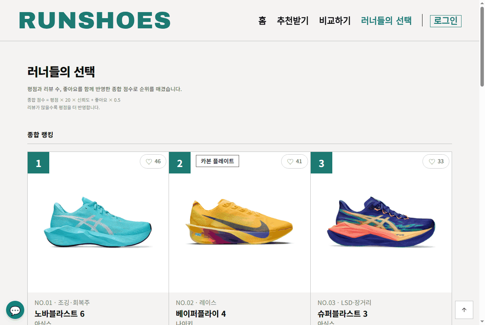

<!--
다루는 곳: src/pages/Best.tsx, src/components/ShoeCard.tsx, backend/src/main/java/com/kopo17/runshoes/api/Ratings.java
읽은 커밋: 0fd9641
-->
# 러너들의 선택

> 이 글은 평점과 리뷰 수와 찜으로 세운 순위 화면과, 그 순위를 만든 리뷰가 무엇인지를 함께 보여 드립니다.

**러너들의 선택은 평점, 리뷰 수, 찜 수를 한 식으로 묶은 종합 점수로 러닝화의 순위를 매기는 화면입니다. 다만 그 리뷰는 실제 러너가 아니라 가상 사용자가 쓴 것이라, 이 순위는 실제 평판이 아닙니다.** [docs:02_screens.md:68] [docs:01e_seed_reviews.md:10]

이 순위를 만든 리뷰 1,800건(2026-11-17 운영 공개 API)은 실제 러너가 쓴 것이 아니라, 가상 사용자 200명이 실제로 나와 있는 러닝화를 신어 본 것처럼 꾸며 쓴 시드 데이터(서비스를 열 때 둘러볼 거리로 미리 넣어 두는 데이터)입니다. [docs:01e_seed_reviews.md:6] [docs:01e_seed_reviews.md:10] 찜 2,090개와 "도움이 돼요" 3,893개도 같은 가상 사용자들이 누른 것으로 만들었습니다(2026-11-17 운영 공개 API). [docs:01e_seed_reviews.md:6] 사이트에는 리뷰마다 "예시" 표시를 달지 않기로 해서 이 화면에도 그런 표시는 없습니다. 그러니 사진의 1위는 실제 러너들이 고른 신발이 아니라 가상 사용자들이 고른 신발로 읽으셔야 합니다. [docs:01e_seed_reviews.md:21] [docs:overview.md:81]

## 종합 점수로 세운 순위

화면은 종합 1위부터 5위까지와, 조깅과 회복주, 템포와 인터벌, 장거리, 레이스, 트레일 용도별 1위를 보여 드립니다. [docs:02_screens.md:72] [code:src/pages/Best.tsx:11] 카드 아래에는 종합 점수와 함께 평점, 리뷰 수가 적힙니다. [code:src/components/ShoeCard.tsx:75]

점수를 매기는 식은 사진처럼 화면에 그대로 적어 둡니다. 식의 신뢰도는 리뷰 수를 리뷰 수에 3을 더한 값으로 나눈 것이라 리뷰가 적을수록 작아집니다. 그래서 리뷰가 1개면 평점의 25%만, 3개면 50%, 10개면 약 77%가 반영되고, 찜 수는 보조로 조금 더합니다. [docs:02_screens.md:68] [docs:02_screens.md:71] 같은 식은 추천받기에서 점수가 같은 신발의 순서를 정할 때도 씁니다(→ 「추천받기」). [docs:10_recommend.md:47]

## 시드 리뷰는 어떻게 만들었나

만드는 순서는 거꾸로입니다. 누가, 어느 신발에, 별 몇 개를, 언제, 몇 글자로 쓸지를 스크립트가 먼저 정하고, 글은 마지막에 그 칸에 맞춰 AI가 채웠습니다. [docs:01e_seed_reviews.md:10] 별점의 출발점은 신발마다 정한 평균(3.3에서 4.6 사이)이고, 그 평균에는 우리 설명문과 해외 리뷰 사이트 원문에서 고른 평가 문장을 근거로 붙였습니다. [docs:01e_seed_reviews.md:32] 그렇게 만든 별점은 5점 38%, 4점 35%, 3점 16%, 2점 7%, 1점 4%이고 평균은 3.96입니다(2026-11-09 1,800건 집계). [docs:01e_seed_reviews.md:35]

리뷰 수도 실제 사이트처럼 고르지 않게 나눠, 인기 있는 신발에는 많이 몰리고 드문 신발에는 한두 건뿐입니다. [docs:01e_seed_reviews.md:25] 가상 사용자 가운데 30명은 체험 카드로 누구나 들어올 수 있는 계정이라, 그 리뷰와 찜은 방문자의 손으로 조금씩 바뀌어 갑니다(→ 「로그인과 체험 계정」). [docs:01e_seed_reviews.md:16] [docs:01e_seed_reviews.md:18] 이 리뷰는 순위 말고도 목록의 평점, 비교하기의 평점, 상세 창의 AI 리뷰 요약, 챗봇의 답에 쓰이고, 챗봇은 이것을 "실제 사용자 후기"라고 단정하지 않고 "등록된 리뷰"라고 부릅니다. [docs:overview.md:81] [docs:01e_seed_reviews.md:21]

## 무엇이 어려웠나

순위의 식은 두 길이 다 그럴듯했습니다. 리뷰 수를 그대로 점수에 더하면 리뷰가 많은 신발이 무조건 이기고, 평점만 보면 리뷰 하나에 5점을 받은 신발이 1위가 됩니다. 그래서 리뷰 수로 평점이 반영되는 비율을 조절하는 식을 골랐습니다. 그 대신 리뷰가 적은 신발은 평점이 높아도 평점의 일부만 점수에 들어갑니다. [docs:02_screens.md:95] [docs:02_screens.md:71]

시드 별점을 만들 때도 갈림길이 있었습니다. 처음 목표는 전체 분포를 실제 사이트처럼 맞춰 5점 28%, 평균 3.73이 되게 하는 것이었는데, 신발마다 근거를 붙여 정한 평균을 리뷰 수로 가중해 보니 3.995여서 둘을 함께 맞출 수 없었습니다(2026-11-09). 요청의 핵심이 신발마다 평판이 다르게 보이는 것이라 신발별 평균을 지키고, 전체 분포에서는 1점만 실망한 리뷰로 3~4%까지 올렸습니다. [docs:01e_seed_reviews.md:88]

이 화면에 걸친 한계는 → 「알려진 한계」에 모았습니다. 왜 이렇게 만들었고 무엇이 어려웠는지는 기술문서 [「시드 리뷰 1,800건」](../notion/02_seed_reviews.md)과 [「둘러보기와 상세」](../notion/03_screens/01_browse.md)에 있습니다.
