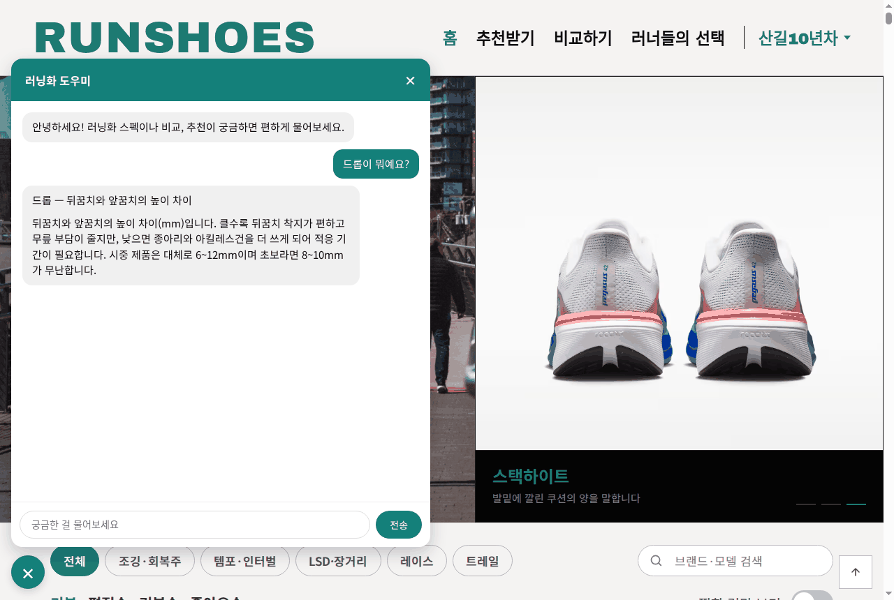
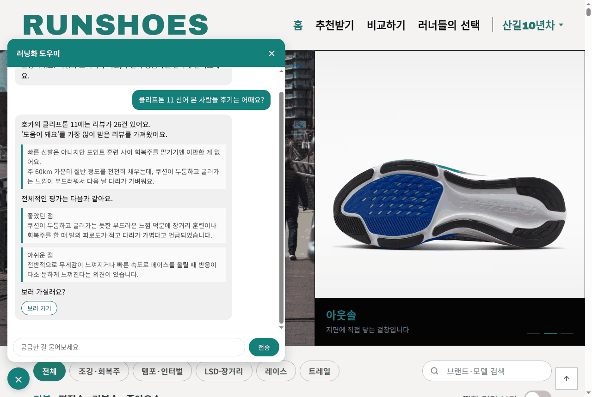

<!--
다루는 곳: chatbot/, src/components/ChatBot.tsx, backend/src/main/java/com/kopo17/runshoes/compare/, backend/src/main/java/com/kopo17/runshoes/summary/
읽은 커밋: 3e0d241
-->
# 챗봇

> 이 글은 화면 왼쪽 아래의 챗봇에게 신발을 말로 물으면 무엇이 돌아오고, 그 답을 누가 짓는지를 보여 드립니다.

**챗봇은 이 사이트에 등록된 신발과 리뷰만 근거로 답합니다. 숫자와 세는 문장은 코드가 데이터에서 그대로 옮기고, 언어 모델(글을 읽고 이어지는 글을 지어내는 AI)은 그 둘레의 말만 다듬습니다.** [docs:09_chatbot_rag.md:10] [docs:09_chatbot_rag.md:28]

## 질문을 여섯 갈래로 나눕니다

질문이 들어오면 챗봇은 먼저 그것이 용어, 스펙, 비교, 추천, 특성 설명, 경험과 후기 가운데 어느 갈래인지 나누고, 갈래마다 답을 만드는 길을 따로 둡니다. [docs:09_chatbot_rag.md:10] [docs:09_chatbot_rag.md:17-24] 위 사진의 "드롭이 뭐예요?"는 용어 갈래라서 언어 모델을 부르지 않고 사이트 용어 사전의 풀이를 그대로 내보냅니다. 화면의 용어 풀이가 이 사이트에서 그 말의 뜻을 정하는 곳이라, 챗봇이 다른 풀이를 지어내면 둘이 어긋나기 때문입니다. [docs:09_chatbot_rag.md:19] [docs:09_chatbot_rag.md:320] [docs:09_chatbot_rag.md:322]

비교와 추천은 챗봇이 따로 계산하지 않고, 비교하기와 추천받기 화면이 쓰는 서버의 계산을 그대로 불러 옵니다. 그래서 같은 질문에 화면과 챗봇이 같은 답을 냅니다. [docs:09_chatbot_rag.md:29] [docs:09_chatbot_rag.md:116] "무릎이 아픈데 뭐 신지?" 같은 몸에 관한 질문은 거절하지 않고 받되, 답 맨 앞에 전문의 안내를 한 번 두고 신발 이야기만 합니다. [docs:09_chatbot_rag.md:295] [docs:09_chatbot_rag.md:300] 말투는 러닝화 담당자의 해요체이고 이모지는 쓰지 않습니다. [docs:09_chatbot_rag.md:355] [docs:09_chatbot_rag.md:357]

## 후기를 물으면 리뷰를 셉니다

신발 하나의 후기를 물으면 챗봇은 그 신발의 리뷰를 전부 가져와 건수부터 말합니다. 사진의 "리뷰가 26건"이 그 수입니다(2026-11-19 운영 화면). [docs:09_chatbot_rag.md:263] [docs:09_chatbot_rag.md:267-269] 이어서 '도움이 돼요'를 가장 많이 받은 리뷰 하나를 원문 그대로 옮기고, 좋았던 점과 아쉬운 점은 신발 상세 창에 뜨는 리뷰 요약을 그대로 붙입니다. 이 답에서는 언어 모델을 부르지 않습니다. [docs:HISTORY.md:80] [docs:05_api_contract.md:20] "발볼 끼나요?"처럼 한 가지를 물으면, 그 이야기를 한 리뷰가 전체 몇 건 가운데 몇 건이고 그중 좋다는 쪽과 아쉽다는 쪽이 각각 몇 건인지를 코드가 세어 문장으로 씁니다. [docs:09_chatbot_rag.md:273]

이 리뷰 1,800건(2026-11-17 운영 공개 API)은 실제 사용자가 아니라 가상 사용자 200명이 쓴 것으로 꾸민 시드 데이터입니다. 그래서 챗봇은 "러너들이", "실제 사용자 후기" 같은 말을 쓰지 않고 등록된 리뷰로만 말합니다. [docs:01e_seed_reviews.md:10] [docs:09_chatbot_rag.md:279] [docs:09_chatbot_rag.md:281] 신발을 말한 답 아래에는 "보러 가기" 버튼이 하나 붙어, 한 켤레면 상세 창을, 여러 켤레면 비교하기를 엽니다. [docs:02_screens.md:87]

## 로그인한 사람만 씁니다

챗봇 버튼은 누구에게나 보이지만, 로그인하기 전에 누르면 "챗봇은 로그인한 뒤에 쓸 수 있어요. 체험 계정으로 바로 둘러볼 수 있어요."라는 안내와 로그인 버튼이 뜹니다(→ 「로그인과 체험 계정」). [docs:09_chatbot_rag.md:439] 챗봇은 파이썬으로 만든 별도 프로그램으로 웹 서버 옆에서 돌며 필요한 데이터를 그때그때 서버에 묻고, 답을 짓는 언어 모델은 호스트에서 이미 돌던 것을 그대로 씁니다. [docs:09_chatbot_rag.md:457] [docs:09_chatbot_rag.md:347]

## 답은 문항으로 잽니다

답의 품질은 평가 문항 94개로 잽니다. 문항마다 답의 숫자가 데이터와 맞는지, 몸에 관한 질문에 전문의 안내가 빠지지 않았는지를 보고, 2026-11-14 평가에서는 94개가 모두 통과했습니다. [docs:09_chatbot_rag.md:511] 무엇을 어떻게 재는지는 기술문서 [「평가와 바꿔 온 길」](../notion/08_chatbot/06_eval.md)에 있습니다.

## 무엇이 어려웠나

처음 나온 설계안은 챗봇을 Node로 다시 쓰고, 비교와 추천 계산도 챗봇 쪽에 한 벌 더 두는 길이었습니다. 하지만 계산이 두 벌이면 가중치 하나를 고칠 때 양쪽을 고쳐야 하고, 둘이 다른 답을 내면 그것이 곧 버그입니다. 그래서 계산은 서버 한 곳에 두고 화면과 챗봇이 함께 부르게 했고, 챗봇은 파이썬으로 남겼습니다. [docs:09_chatbot_rag.md:104] [docs:09_chatbot_rag.md:122] [docs:09_chatbot_rag.md:569]

리뷰로 답할 때도 처음 안은 검색에 걸린 리뷰 건수만 말하는 쪽이었습니다. 그런데 "무릎 편한 신발"로 찾으면 편하다는 리뷰만 걸려 오고, 언어 모델은 자기가 보지 못한 불편하다는 리뷰를 알 길이 없습니다. 그래서 검색은 볼 신발을 고르는 데만 쓰고, 답에는 그 신발 리뷰 전체의 건수를 함께 적는 쪽을 골랐습니다. [docs:09_chatbot_rag.md:265] [docs:09_chatbot_rag.md:573]

이 화면에 걸친 한계는 → 「알려진 한계」에 모았습니다. 왜 이렇게 만들었고 무엇이 어려웠는지는 기술문서 [「챗봇」](../notion/08_chatbot.md)에 있습니다.
