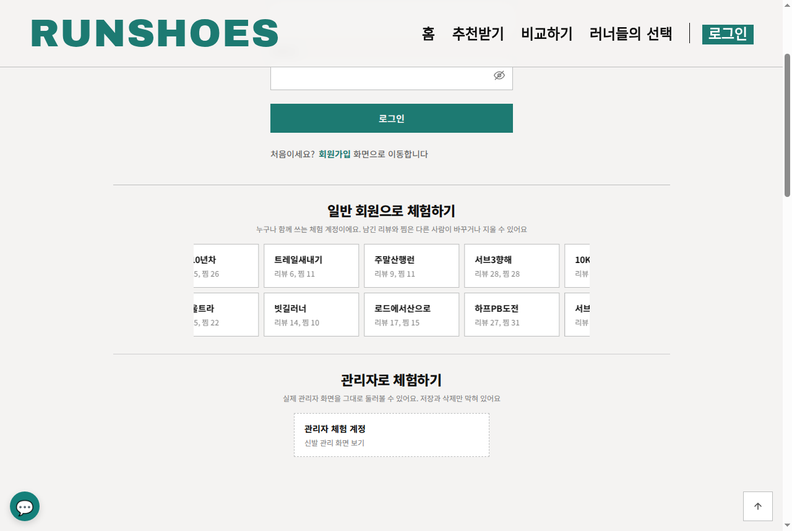
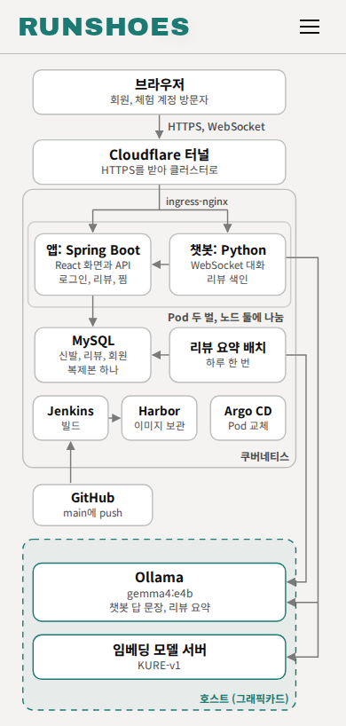
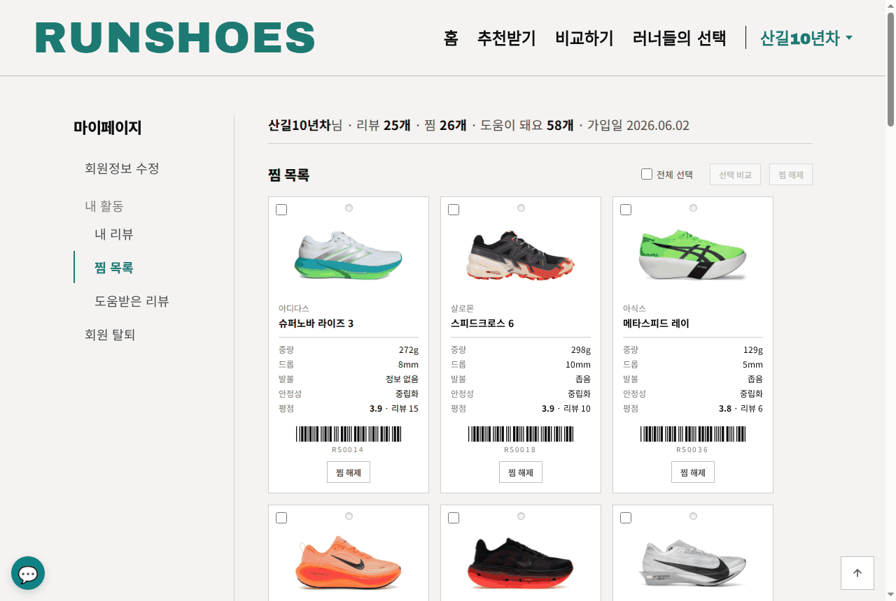

<!--
다루는 곳: src/pages/Login.tsx, src/pages/Account.tsx, src/auth/, src/components/About.tsx, src/components/ArchDiagram.tsx, backend/src/main/java/com/kopo17/runshoes/auth/
읽은 커밋: de50133
-->
# 로그인과 체험 계정

> 이 글은 가입하지 않고 체험 카드 한 장으로 들어가 찜과 리뷰를 남겨 보는 로그인 화면과, 그 아래 이어지는 사이트 소개, 로그인해야 보이는 마이페이지를 보여 드립니다.

**신발을 둘러보고 비교하는 데는 로그인이 필요 없습니다. 리뷰와 찜, 챗봇은 계정이 있어야 쓸 수 있는데, 처음 오신 분은 가입 없이 체험 계정 카드를 눌러 바로 들어오실 수 있습니다.** [docs:08_compare.md:28] [docs:04_auth.md:36] [docs:09_chatbot_rag.md:433] [docs:04_auth.md:10]

## 체험 카드로 들어옵니다

로그인 화면에는 이메일과 비밀번호 칸 아래에 "일반 회원으로 체험하기"와 "관리자로 체험하기"가 있습니다. 일반 회원 쪽은 미리 만들어 둔 가상의 사용자(시드 사용자) 계정 카드가 리뷰 수, 찜 수와 함께 천천히 흐르고, 카드를 누르면 비밀번호 없이 그 계정으로 들어갑니다. [docs:04_auth.md:55-59] 카드는 시드 사용자 30장과 데모 관리자 1장, 모두 31장입니다(2026-11-17 운영 공개 API). [docs:04_auth.md:6] 데모 관리자는 관리 화면을 다 볼 수 있지만 쓰기는 서버가 모두 거절합니다(→ 「관리 화면」). [docs:04_auth.md:38]

체험 계정은 여럿이 함께 씁니다. 그래서 화면에 "누구나 함께 쓰는 체험 계정이에요. 남긴 리뷰와 찜은 다른 사람이 바꾸거나 지울 수 있어요"라고 적어 두었고, 방문자가 바꾼 것은 되돌리지 않고 그대로 둡니다. [docs:04_auth.md:67] [docs:04_auth.md:68] 시드 계정은 닉네임을 바꾸거나 탈퇴할 수 없습니다. 그것이 되면 카드로 들어온 누구나 시드 이름을 바꾸거나 지울 수 있게 되기 때문입니다. [docs:04_auth.md:65]

## 로그인 화면 아래 소개

로그인 화면을 아래로 내리면 이 사이트를 소개하는 글이 이어집니다. 처음 오신 분이 30초 안에 RUNSHOES가 무엇인지 아실 수 있게 둔 자리입니다. [docs:02_screens.md:93] 한 줄 소개와 두 문단, 화면에서 할 수 있는 것 넷, 서비스 구성도 한 장, 쓴 기술의 이름이 차례로 나옵니다. [docs:02_screens.md:94] 소개 글은 설계 문서가 아니라 지금 돌고 있는 코드와 운영 설정을 보고 썼고, 모델 이름도 코드가 부르는 그대로 적었습니다. 문서를 보고 쓰면 문서가 낡을 때 소개도 같이 낡기 때문입니다. [docs:02_screens.md:95]

휴대폰 사진은 화면 아래 양쪽에 늘 떠 있는 단추 둘(왼쪽 챗봇, 오른쪽 맨 위로)이 구성도 아래쪽을 가려, 이 사진에서만 그 둘을 감추고 찍었습니다.

구성도는 넓은 화면에서는 가로로, 휴대폰에서는 세로로 그립니다. 가로 그림을 휴대폰 폭으로 줄이면 글자가 읽기 어려울 만큼 작아져서 두 장을 따로 그렸습니다. 그림에는 바깥에서 들어오는 길, 쿠버네티스(여러 서버에 앱을 나눠 띄우고 관리하는 도구) 안에서 도는 것, 쿠버네티스 밖에서 그래픽카드를 쓰는 모델 서버 둘, 코드를 올리면 새 판이 배포되는 길이 함께 있습니다. [docs:02_screens.md:97] 휴대폰부터 넓은 모니터까지 여섯 가지 화면 폭에서, 화면이 옆으로 넘치거나 그림 글자가 겹치지 않는지 재고 사진으로 다시 보았습니다. [docs:02_screens.md:98]

## 로그인은 두 가지 토큰으로 지킵니다

로그인하면 서버가 두 가지 토큰(로그인했다는 것을 증명하는 짧은 글자열)을 줍니다. 요청마다 붙이는 access 토큰은 15분 동안 통하고 화면의 메모리에만 둡니다. access 토큰을 새로 받을 때 쓰는 refresh 토큰은 14일 동안 통하고, 화면의 자바스크립트가 읽을 수 없는 쿠키에 담겨 로그인 관련 주소에만 붙습니다. [docs:04_auth.md:18] [docs:04_auth.md:19] 새로 고침해도 그 쿠키로 access 토큰을 다시 받으니 로그인이 풀리지 않습니다. [docs:04_auth.md:26] 찜 수, 평점, 작성자처럼 세거나 정하는 값은 화면이 보낸 값을 믿지 않고 모두 서버가 정합니다. [docs:04_auth.md:10]

비밀번호를 거듭 틀리면 로그인을 막습니다. 같은 이메일로 15분 안에 다섯 번 틀리면 마지막 실패에서 15분 동안 맞는 비밀번호로도 들어갈 수 없고, 화면은 그동안 안내 문구를 띄우고 로그인 단추를 끕니다. 접속한 곳마다 따로 세는 제한(15분에 20번)도 함께 둡니다. [docs:04_auth.md:76] [docs:04_auth.md:77] [docs:04_auth.md:83]

## 마이페이지의 찜 목록

로그인해야 보이는 마이페이지는 본문 맨 위에 늘 리뷰, 찜, 도움이 돼요 수와 가입일이 있고, 왼쪽 목차는 회원정보 수정, 내 활동(내 리뷰, 찜 목록, 도움받은 리뷰), 회원 탈퇴입니다. [docs:02_screens.md:76-77] 사진의 체험 계정은 리뷰 25개, 찜 26개입니다(2026-11-19 운영 화면).

찜 목록은 고른 신발을 나란히 놓고 견주는 곳이라, 카드마다 중량, 드롭, 발볼, 안정성, 평점과 리뷰 수를 같은 순서로 둡니다. 카드는 옷에 다는 가격표처럼 위에 끈 구멍, 아래에 바코드가 있습니다. 여러 켤레를 골라 한꺼번에 찜을 풀거나, 두 켤레에서 다섯 켤레까지 골라 "선택 비교"로 비교하기를 열 수 있습니다(→ 「비교하기」). [docs:02_screens.md:79]

## 무엇이 어려웠나

토큰을 어디에 둘지가 첫 갈림길이었습니다. 브라우저 저장소에 두면 다루기 쉽지만, 화면에 악성 스크립트가 한 번 끼어들면 토큰이 그대로 빠져나갑니다. 그래서 access 토큰은 메모리에만 두고 refresh 토큰은 스크립트가 읽을 수 없는 쿠키에 담아 로그인 관련 주소에만 붙였습니다. 다른 사이트가 쿠키를 몰래 실어 보내는 공격의 대상도 그 주소로 좁혀집니다. [docs:04_auth.md:108]

체험 카드에 누구를 넣을지도 정해야 했습니다. 실제 가입자까지 넣으면 둘러볼 계정은 늘지만, 카드를 누른 누구나 그 사람 이름으로 리뷰를 쓸 수 있게 됩니다. 남의 이름으로 리뷰가 달리면 안 된다고 보고 체험 계정은 시드 사용자 30명만으로 했고, 그래서 이 30명의 리뷰와 찜은 방문자 손으로 바뀌어 갑니다. [docs:04_auth.md:112] [docs:04_auth.md:68]

이 화면에 걸친 한계는 → 「알려진 한계」에 모았습니다. 왜 이렇게 만들었고 무엇이 어려웠는지는 기술문서 [「로그인과 체험 계정」](../notion/07_auth.md)에 있습니다.
