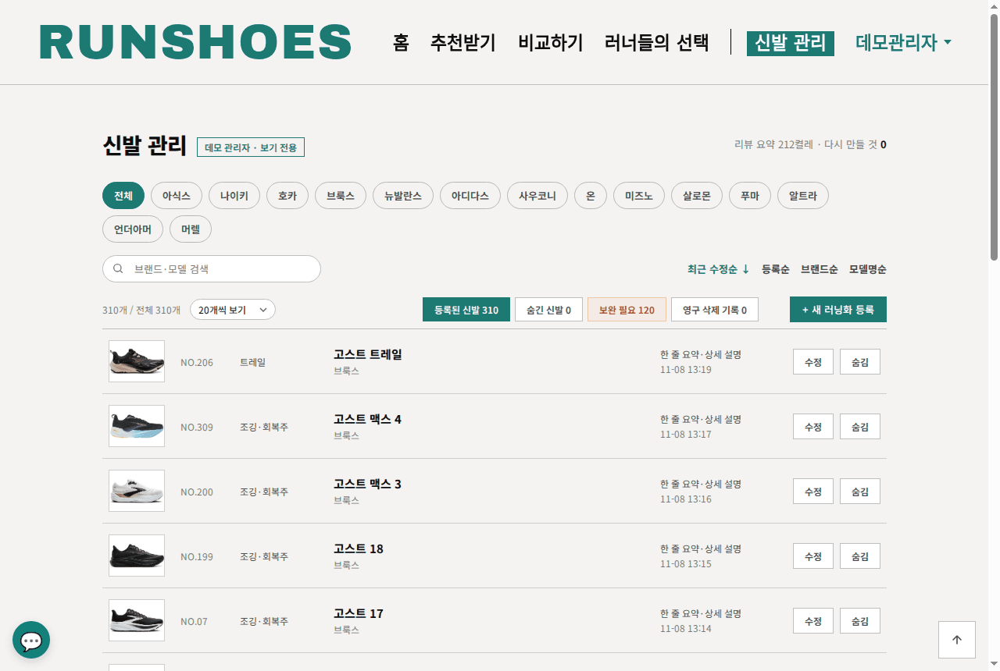
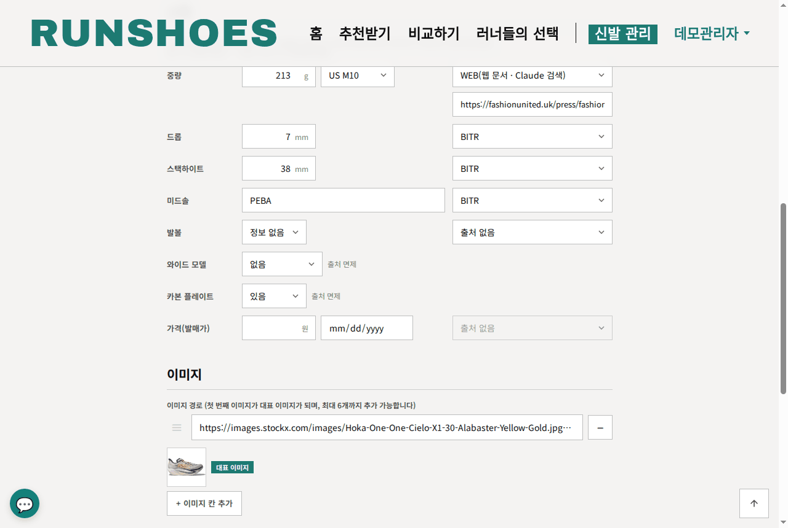
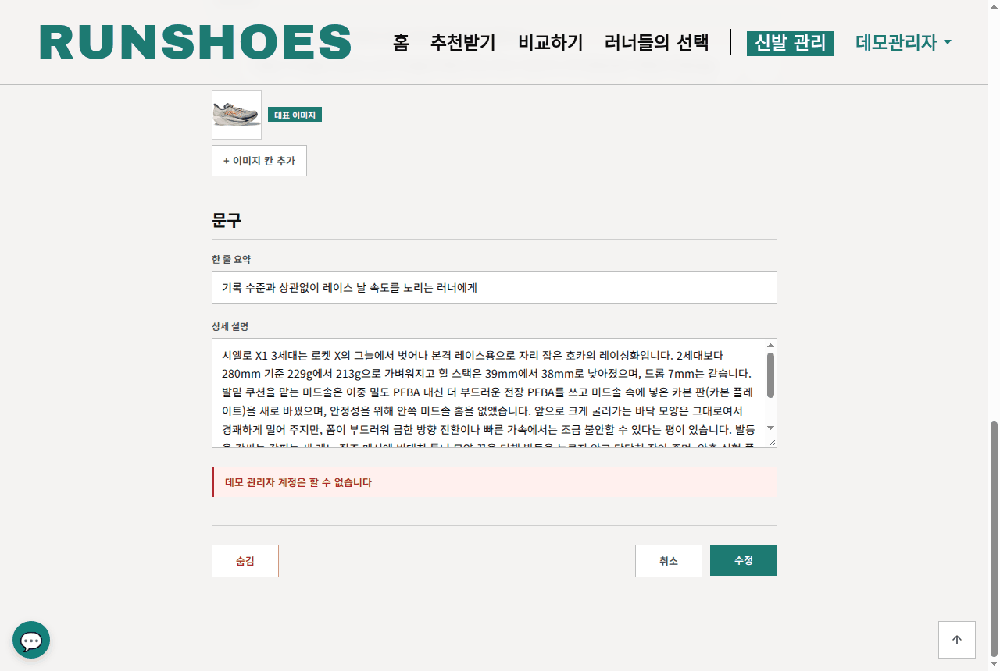

<!--
다루는 곳: src/pages/Admin.tsx, src/pages/ShoeForm.tsx, src/components/HideShoeConfirm.tsx, backend/src/main/java/com/kopo17/runshoes/api/
읽은 커밋: 0fd9641
-->
# 관리 화면

> 이 글은 신발을 등록하고 고치고 숨기는 관리 화면을, 처음 보는 분이 쓰는 데모 관리자 계정으로 둘러본 모습으로 보여 드립니다.

**관리 화면은 칸마다 그 값을 어디서 읽었는지를 함께 저장하고, 근거 없는 값이 생기지 않게 막는 곳입니다. 데모 관리자 계정으로 들어오면 실제 화면을 그대로 둘러볼 수 있고, 저장만 서버가 막습니다.** [docs:03_admin.md:10] [docs:03_admin.md:82-83]

## 네 탭으로 나눈 목록

신발 관리 화면에는 탭이 넷 있습니다. 등록된 신발은 전체 목록이고 최근 수정순이 기본입니다. 숨긴 신발에서는 숨긴 신발을 되살리거나 영구히 지우고, 영구 삭제 기록은 지운 신발과 지울 때의 리뷰 수와 찜 수를 읽기만 하는 목록입니다. [docs:03_admin.md:22-25] 줄마다 마지막 수정에서 바뀐 칸 이름이 두 개까지와 고친 시각이 보여, 언제 무엇을 고쳤는지 한눈에 알 수 있습니다. [docs:03_admin.md:28]

보완 필요는 빈 칸이 있는 신발을 모은 탭으로, 운영 310켤레 가운데 120켤레입니다(2026-11-17 운영 공개 API). [docs:03_admin.md:6] 가격, 발볼, 와이드 모델(발볼이 넓은 사람을 위해 같은 신발을 넓게 만든 판), 무게 같은 열 가지 칸을 보는데, 와이드와 카본은 "모름"만 빈 칸으로 세고 "없음"은 확인한 값이라 세지 않습니다. [docs:03_admin.md:27] 기본 정렬은 빈 칸이 적은 순이라, 한 칸만 빈 신발부터 고치면 목록이 빨리 줄어듭니다. [docs:03_admin.md:24]

## 칸마다 출처를 고르는 폼

스펙 칸마다 옆에 출처를 고르는 칸이 있습니다. 데이터를 모을 때 쓴 리뷰 사이트와 매장 이름 외에, 웹 문서에서 찾은 값(WEB)과 사람이 직접 확인한 값(MAN)을 고를 수 있고, 이 둘은 확인한 주소를 꼭 적어야 합니다. [docs:03_admin.md:51] 가격(발매가)에는 확인한 날과 출처 칸이 따로 있습니다. [docs:03_admin.md:44]

값을 바꾸면 그 칸의 출처를 다시 고르게 해서, 옛 출처가 새 값에 붙어 남지 않게 합니다. 값을 비우면 출처도 비웁니다. [docs:03_admin.md:60] [docs:03_admin.md:61] 와이드 모델 "없음"은 카본처럼 출처를 고르지 않아도 되어 화면에 "출처 면제"가 보이고, 데이터에는 검색해도 찾지 못했다는 표식을 남깁니다. [docs:03_admin.md:62] 무게, 드롭, 스택하이트는 숫자와 소수점 한 자리만 받고, 서버도 숫자가 아니면 거절합니다. [docs:03_admin.md:66] 여기서 고친 값은 다음에 신발 데이터를 다시 모아 넣을 때도 되돌려지지 않습니다. [docs:03_admin.md:10]

## 숨김과 영구 삭제

폼 아래의 숨김 단추는 신발을 지우지 않고 사이트에서만 보이지 않게 합니다. 확인 창에는 그 신발의 리뷰 수와 찜 수가 보입니다. [docs:03_admin.md:73] 숨긴 신발은 목록과 상세와 찜에서 빠지지만 리뷰와 찜은 데이터베이스에 남아, 되살리면 그대로 돌아옵니다. [docs:03_admin.md:74] 영구 삭제는 숨긴 신발에만 할 수 있습니다. 지우기 전에 기록을 남기고, 신발 데이터를 다시 넣는 프로그램이 그 기록을 읽어 지운 신발을 되살리지 않습니다. [docs:03_admin.md:75]

## 데모 관리자는 보기만 합니다

데모 관리자는 처음 보는 분이 관리 화면을 둘러보도록 둔 체험 계정입니다. 목록과 폼은 다 보이지만 저장, 숨김, 되살리기, 영구 삭제는 서버가 거절하고, 화면은 서버가 보낸 "데모 관리자 계정은 할 수 없습니다"를 그대로 띄웁니다. [docs:03_admin.md:82-83] 화면에서만 막지 않은 것은, 화면을 거치지 않고 서버에 바로 요청을 보내면 화면의 막음을 건너뛸 수 있기 때문입니다. [docs:03_admin.md:85] 데모 관리자로 들어가는 길은 → 「로그인과 체험 계정」에 있습니다.

## 무엇이 어려웠나

삭제를 어디까지 지울지가 첫 갈림길이었습니다. 바로 지우는 것이 단순했지만, 그러면 거기 달린 리뷰와 찜이 함께 사라집니다. 그래서 지우지 않고 숨기게 해 실수로 숨겨도 되살릴 수 있게 했고, 정말 지워야 할 때 쓰는 영구 삭제를 따로 두었습니다. [docs:03_admin.md:160] 대신 단추에는 "삭제"라고 적혀 있는데 실제로는 숨기는 어긋남이 생겨, 영구 삭제를 만들면서 두 이름을 나눴습니다. [docs:03_admin.md:170]

예와 아니오만 고르는 칸도 문제였습니다. 예전 폼은 카본과 와이드가 체크박스라 한 번 누르면 있음과 없음만 남아, 확인하지 않은 "없음"이 생겼습니다. 발볼에는 "정보 없음"이 없어, 값이 빈 210행에 첫 선택지 "좁음"이 보였습니다(2026-11-02). [docs:03_admin.md:157] 찾지 못한 것은 없는 것이 아니라고 보고 근거 없이 "없음"이 된 와이드 23행을 비웠고(2026-11-02), 이제 모든 사실 칸에서 정보 없음을 고를 수 있습니다. [docs:03_admin.md:158] [docs:03_admin.md:157] 그만큼 빈 칸이 그대로 드러나, 보완 필요 목록은 길게 남습니다. [docs:03_admin.md:177]

이 화면에 걸친 한계는 → 「알려진 한계」에 모았습니다. 왜 이렇게 만들었고 무엇이 어려웠는지는 기술문서 [「관리 화면」](../notion/06_admin.md)에 있습니다.
