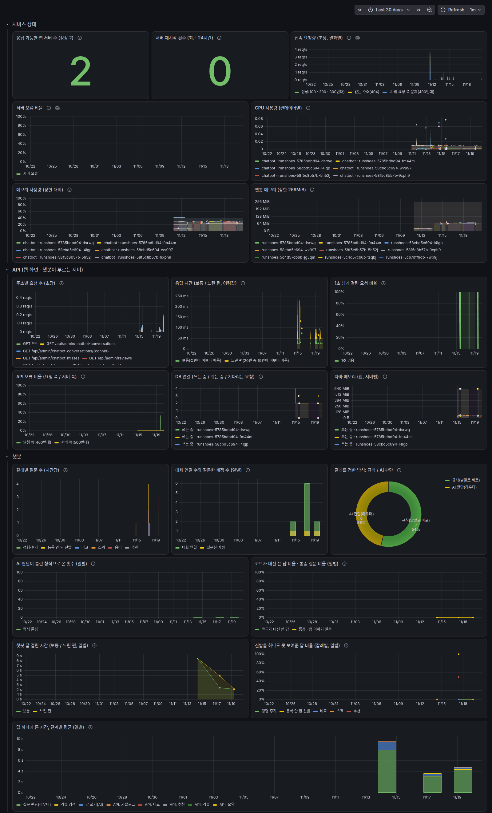

<!--
다루는 곳: backend/src/main/resources/application.yml, backend/src/main/java/com/kopo17/runshoes/activity/ActivityCleanup.java, backend/src/main/resources/db/migration/V19__chatbot_turns.sql
읽은 커밋: 0d49616
-->
# 모니터링

> 이 글은 RUNSHOES가 잘 돌고 있는지를 무엇으로, 어떻게 지켜보는지를 대시보드 한 장으로 보여 드립니다.

**서비스가 떠 있는지, 요청에 얼마나 빨리 답하는지, 오류가 얼마나 나는지를 Grafana 대시보드 「runshoes 운영」 한 장에서 봅니다. 앞의 관리 화면이 사이트 안에서 신발을 고치는 곳이라면, 이 대시보드는 서버가 잘 도는지 숫자로 보는 곳입니다.** [docs:06_deployment.md:168] [docs:06_deployment.md:187]

## 무엇을 보고 있나

대시보드는 일곱 묶음, 패널 36개로 되어 있습니다(2026-11-20). 사진은 그 가운데 위의 세 묶음입니다. [docs:06_deployment.md:171]

- **떠 있는지**: 맨 위 큰 숫자 2는 지금 요청을 받을 수 있는 앱 서버 수입니다. 서버 두 대가 서로 다른 노드(클러스터를 이루는 가상 머신)에서 돌고, 둘 다 받을 수 있으면 2입니다. 배포하는 동안은 한 대씩 바꾸어 잠깐 1이 됩니다. 옆의 0은 최근 24시간 동안 서버가 고장으로 꺼졌다 다시 켜진 횟수입니다. [docs:06_deployment.md:175] [docs:06_deployment.md:85]
- **얼마나 빠른지**: API 묶음의 응답 시간이 서버가 요청을 받아 답하기까지 걸린 시간을 "보통"과 "느린 편" 두 선으로 보여 드립니다. 1초 넘게 걸린 요청이 몇 퍼센트인지도 따로 셉니다. [docs:06_deployment.md:176]
- **오류가 얼마나 나는지**: 서버 오류 비율과 API 오류 비율을 봅니다. 로그인하지 않고 쓰기를 누른 것 같은 요청 쪽 오류는 늘 조금 있고, 서버 쪽 오류는 0이어야 정상입니다. [docs:06_deployment.md:176]

그 아래에는 챗봇 묶음(질문 수, 답에 걸린 시간을 단계별로), 그래픽카드 묶음, 사이트 활동 묶음, 리뷰 요약 배치 묶음, 서버 로그 묶음이 이어집니다. [docs:06_deployment.md:177-181]

**사이트 활동 묶음의 "리뷰 쓰기" 칸은 늘 비어 있습니다. 고장이 아닙니다.** 이 칸은 화면에서 새로 쓴 리뷰만 세는데, 지금까지 화면에서 쓴 리뷰가 한 건도 없습니다. 사이트의 리뷰 1,800건은 가상 사용자 200명이 쓴 것으로 꾸며 미리 넣어 둔 시드 데이터라 이 칸에 세지 않습니다(2026-11-20 운영 공개 API). [docs:06_deployment.md:185] [docs:01e_seed_reviews.md:10]

## 숫자는 어디서 와서 어디에 쌓이나

입구와 서버가 내는 숫자는 Prometheus가 30초마다 모아 15일 동안 쌓고, 챗봇과 사이트 활동 숫자는 런슈즈 데이터베이스의 복제본을 Grafana가 바로 읽으며, 서버 로그는 Loki에 7일 동안 쌓입니다. [docs:06_deployment.md:158-161]

## 아직 보지 않는 것

- **알림이 없습니다.** 무언가 나빠져도 누구를 부르지 않아, 사람이 대시보드를 열어야 압니다. 무엇을 누구에게 알릴지 아직 정하지 않았기 때문입니다. [docs:06_deployment.md:205]
- **응답 시간은 어림값입니다.** 서버가 걸린 시간을 네 구간으로만 세어서, 선은 구간 사이를 이어 짐작한 값입니다. 구간을 잘게 나누면 쌓을 숫자가 크게 늘어 넷만 두었습니다. [docs:06_deployment.md:210]
- **챗봇의 몇 가지는 아직 재지 않습니다.** "보러 가기"를 누른 비율이나 동시에 열린 대화 수 같은 것입니다. 챗봇을 먼저 완성하고 재기로 미뤘습니다. [docs:06_deployment.md:211]
- **브라우저 쪽, 바깥에서 불러 보는 확인, 데이터베이스 자체의 지표는 모으지 않습니다.** 왜 두지 않았는지 기록이 없어, 정할 일로 올려 두었습니다. [docs:06_deployment.md:212-214]

지표를 어떻게 모으는지, 보존 기간이 얼마인지, 알림을 왜 두지 않았는지는 기술문서 [「모니터링」](../notion/10_deploy/01_monitoring.md)에 있습니다.
